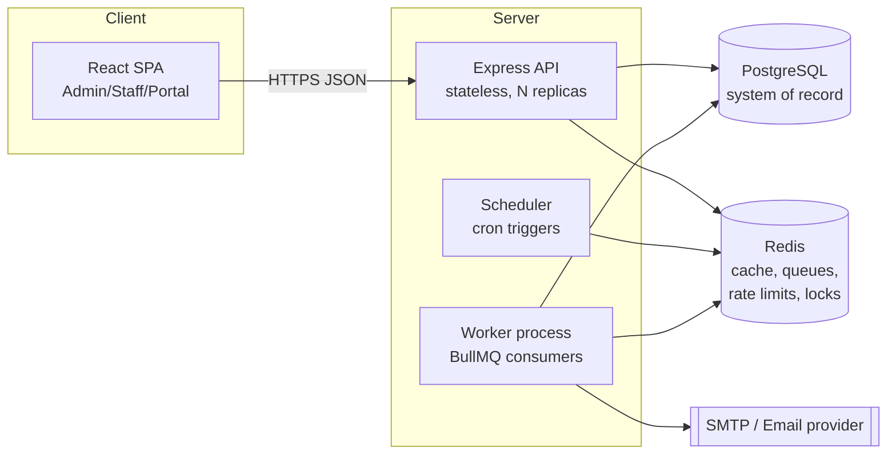
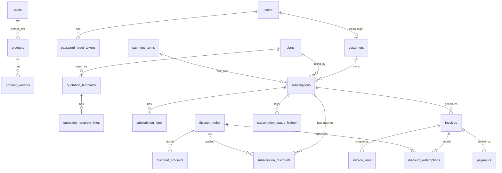
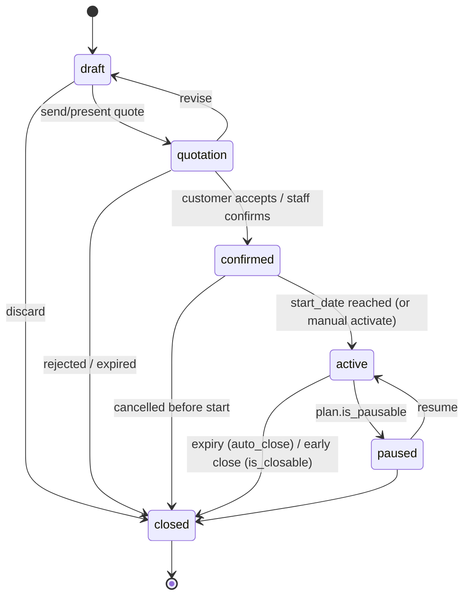
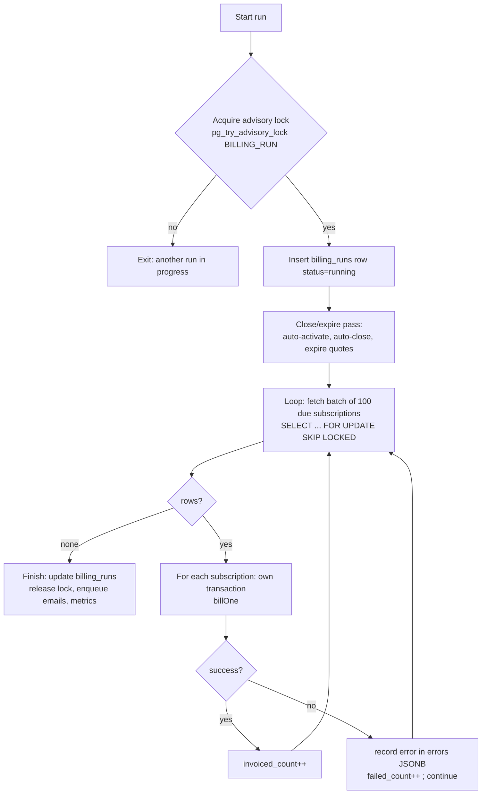
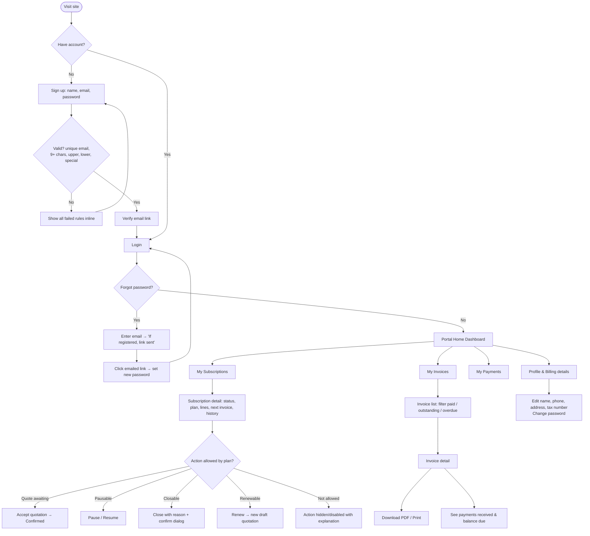
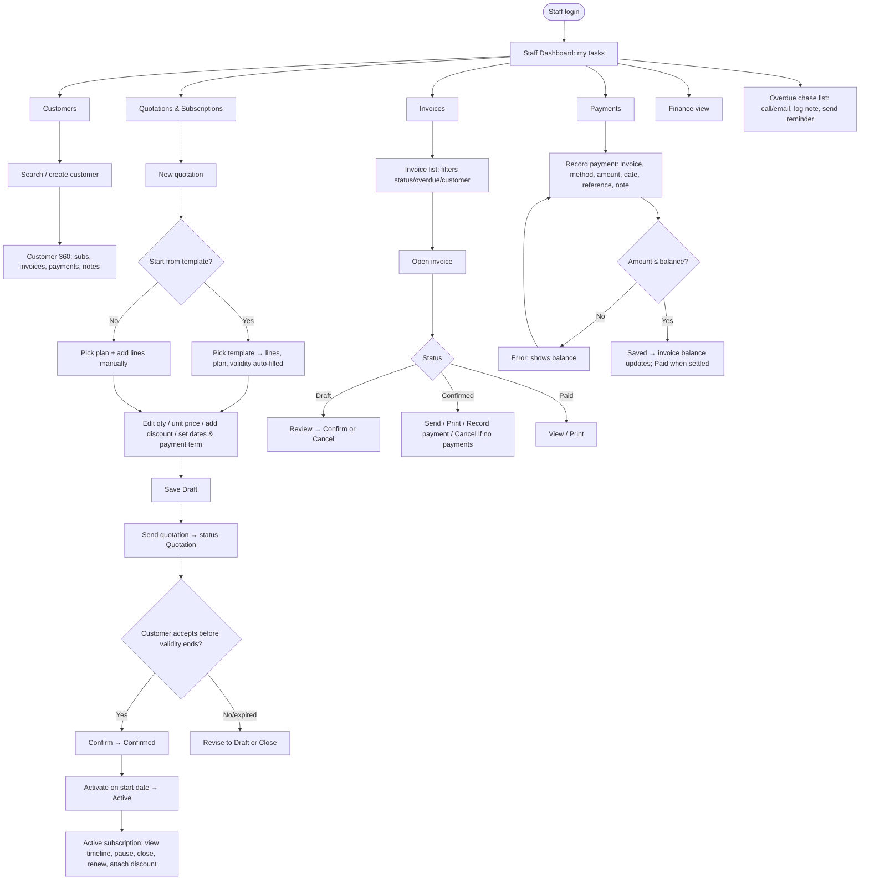
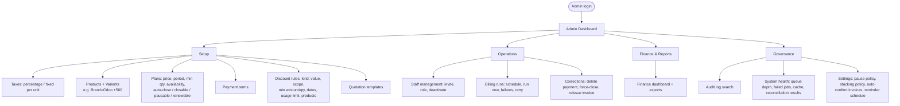
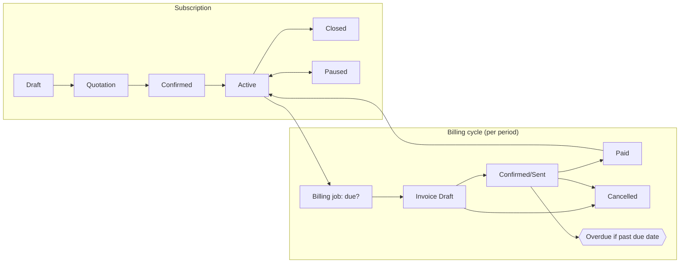

# Subscription Management System — Technical Specification

**Product:** Brightloop Subscription Management System (SMS)
**Stack:** Node.js + Express (API) · React (SPA) · PostgreSQL 14+ (system of record) · Redis (cache, queues, rate limits, locks)
**Status:** Draft v1.0 · **Date:** 2026-10-31
**Companion artifact:** `schema_new.sql` (authoritative DDL; this spec explains how to use it and where it must be extended)

---

## Table of contents

1. Purpose, goals, non-goals
2. Glossary (jargon explained)
3. Personas, roles, and the permission matrix
4. System architecture
5. Data model: invariants and required schema extensions
6. Domain rules (the business logic, precisely)
7. The billing engine (recurring invoice generation)
8. Concurrency, race conditions, and idempotency catalogue
9. Money, rounding, and tax math
10. Caching strategy (Redis)
11. REST API specification
12. Security
13. User flowcharts (customer, staff, admin)
14. Dashboards and screen designs per role
15. Frontend architecture
16. Notifications and email
17. Reporting and performance budget
18. Background jobs, observability, operations
19. Testing strategy
20. Environments, configuration, deployment
21. Delivery plan (milestones)
22. Traceability: brief requirement → spec section
23. Open questions and assumptions

---

## 1. Purpose, goals, non-goals

### 1.1 Purpose
Replace Brightloop's spreadsheet-and-memory process with one platform that runs the full life of a subscription business: **catalog → quotation template → subscription → invoice → payment → reporting**.

Problems being solved (from the brief):

| Today | Result of the new system |
|---|---|
| Subscriptions in a spreadsheet | Single source of truth with a lifecycle and audit trail |
| Renewals remembered by whoever notices | Expiry/renewal driven by data (`expiry_date`, plan flags), automated jobs |
| Invoices typed by hand | Generated by the billing engine from the subscription |
| Payments matched by scrolling bank statements | Payments recorded against the exact invoice; status auto-derived |
| Quarterly manual revenue reports | Live finance dashboard, sub-2-second pages |

### 1.2 Goals
- G1. Nothing billed twice, nothing skipped (hard guarantee, enforced in the database, not only in code).
- G2. Historical documents never change when the catalog changes (price/tax/discount **snapshots**).
- G3. Role-based access: admin, staff, customer; customers can only ever see their own data.
- G4. Billing day with hundreds to thousands of due subscriptions completes unattended, resumably, and observably.
- G5. Every page responds in < 2 s with thousands of subscriptions (p95).
- G6. Full audit trail of state changes and money movements.

### 1.3 Non-goals (v1)
- Online card capture / payment gateway integration (payments are *recorded*, not collected). The data model leaves room (see §23).
- Multi-currency and FX (single currency per deployment; `NUMERIC(12,2)`).
- Proration on mid-period quantity changes (see §23 for proposed v2 approach).
- Dunning automation beyond reminder emails.
- Multi-tenant SaaS (one company, Brightloop).

---

## 2. Glossary (jargon explained)

| Term | Meaning in this system |
|---|---|
| **Subscription** | A contract: a customer buys a set of products on a plan, billed repeatedly until it ends. |
| **Plan** | The billing definition: price, billing period (daily/weekly/monthly/yearly), min quantity, availability window, and behaviour flags (auto-close, closable, pausable, renewable). |
| **Billing period / cycle** | The span of time one invoice covers, e.g. 2026-11-01 → 2026-11-30 for monthly. |
| **Quotation** | A subscription in `draft`/`quotation` state: an offer not yet accepted. |
| **Quotation template** | Reusable starting point: a plan + product lines + validity days. |
| **Variant** | A product option (e.g. Brand = Odoo) that adds `extra_price`. |
| **Unit price (snapshot)** | Price copied onto a line at creation = `product.sales_price + variant.extra_price`. Later catalog edits don't change it. |
| **Draft / Confirmed / Paid / Cancelled** | Invoice statuses. "Confirmed" = issued and awaiting payment (sent/owed). |
| **Overdue** | A *computed* condition: invoice is `confirmed` and `due_date < today`. Never stored. |
| **Payment term** | Rule giving `due_date = invoice_date + due_days` (Immediate, Net 15, Net 30). |
| **Tax (percentage vs fixed)** | Percentage tax: rate % of taxable amount. Fixed tax: an amount **per unit**. |
| **Taxable amount** | `line_subtotal − line_discount` (tax is computed after discount). |
| **Discount rule** | Admin-defined fixed/percentage discount with thresholds, dates, usage limit; scoped to specific products or whole subscriptions. |
| **Redemption** | One use of a discount on one invoice (`discount_redemptions`). |
| **MRR** | Monthly Recurring Revenue: normalized monthly value of active subscriptions (before discount and tax). |
| **ARR** | Annual Recurring Revenue = MRR × 12. |
| **Churn** | Subscriptions closed in a period relative to active at start. |
| **Billing cursor** | `subscriptions.next_invoice_date`: the date the next invoice is due; advanced after each invoice. |
| **Billing run** | One execution of the scheduled billing job; logged in `billing_runs`. |
| **Catch-up** | If the job missed days, it loops generating each missed period until the cursor passes today. |
| **Idempotency** | Doing an operation twice has the same effect as once. Essential for retries and double-clicks. |
| **Idempotency key** | Client-supplied unique token per logical action so the server can recognize a replay. |
| **Race condition** | Two concurrent operations interleave to produce a wrong result (e.g. two invoices for one period). |
| **Row lock (`FOR UPDATE`)** | PostgreSQL lock preventing other transactions modifying/locking that row until commit. |
| **`SKIP LOCKED`** | Lock variant that skips rows already locked, letting multiple workers share a queue without blocking. |
| **Advisory lock** | Application-defined PostgreSQL lock keyed by an integer; used for "only one billing run at a time". |
| **Isolation level** | How much concurrent transactions see each other. Default `READ COMMITTED`; use explicit locks or `SERIALIZABLE` where needed. |
| **Partial unique index** | Unique constraint over a subset of rows (`WHERE status <> 'cancelled'`); the core of "no double billing". |
| **Optimistic concurrency** | Update only if `updated_at`/version still matches what the user loaded; else 409 Conflict. |
| **Snapshot** | Copy of a value at a point in time on a document so history never shifts. |
| **Soft delete / deactivate** | `is_active=false` instead of `DELETE`, preserving references. |
| **RBAC** | Role-Based Access Control: permissions attached to roles (admin/staff/customer). |
| **IDOR** | Insecure Direct Object Reference: accessing another customer's invoice by guessing its ID. Prevented by ownership filters. |
| **JWT / refresh token** | Signed short-lived access token + longer-lived rotating token to renew it. |
| **bcrypt/argon2** | Slow password hashing algorithms. |
| **Rate limiting** | Restricting requests per time window per key (IP/user), stored in Redis. |
| **Cache-aside** | App checks cache; on miss reads DB and fills cache. |
| **TTL** | Time-to-live of a cache entry. |
| **Outbox pattern** | Write the "send email" intent to a DB table in the same transaction as the business change, then a worker sends it, so emails are never lost or sent for rolled-back changes. |
| **Dead-letter queue (DLQ)** | Where jobs go after exhausting retries, for inspection. |
| **N+1 query** | Anti-pattern of one query per row; avoided with joins/batching. |
| **Keyset pagination** | Paging using "after this id/date" instead of `OFFSET`, stable and fast on large tables. |
| **Materialized view** | Stored query result refreshed on schedule; optional for heavy reports. |
| **Reconciliation** | Verifying invoice totals/payments agree with sums of their parts (nightly check job). |
| **p95** | 95th-percentile latency. |

---

## 3. Personas, roles, and the permission matrix

### 3.1 Personas
- **Admin (e.g. "Operations Head")**: configures the system, owns catalog, taxes, discounts, staff accounts. Full control.
- **Staff (sales rep / account manager / billing clerk)**: runs day-to-day work: customers, quotations, subscriptions, invoices, payments. Cannot change catalog economics (taxes, discount rules, plans, product prices) or create staff.
- **Customer (portal user)**: a small shop or large company; views and manages **only their own** subscriptions and invoices.
- **Finance lead**: a staff or admin user who primarily uses the finance dashboard. (Implemented as a *view*, not a fourth role. See §23 Q3 if a distinct `finance` role is wanted.)
- **System (billing job)**: non-human actor; writes `created_by = NULL`, `changed_by = NULL` for audit.

### 3.2 Permission matrix

Legend: ✅ allowed · 🔒 own records only · 👁 read only · ❌ denied

| Capability | Admin | Staff | Customer |
|---|---|---|---|
| Sign up (public) | — | — | ✅ (creates `customer`) |
| Create staff user | ✅ | ❌ | ❌ |
| Deactivate/reactivate users | ✅ | ❌ | ❌ |
| Manage taxes | ✅ | 👁 | ❌ |
| Manage products & variants | ✅ | 👁 | ❌ |
| Manage plans (incl. flags) | ✅ | 👁 | ❌ |
| Manage payment terms | ✅ | 👁 | ❌ |
| Create/edit discount rules | ✅ | 👁 | ❌ |
| Attach discount to subscription | ✅ | ✅ (existing rules only) | ❌ |
| Manage quotation templates | ✅ | ✅ | ❌ |
| Customers CRUD | ✅ | ✅ | 🔒 (own profile edit) |
| Create/edit subscription (draft/quotation) | ✅ | ✅ | ❌ |
| Confirm/activate/pause/close subscription | ✅ | ✅ | 🔒 limited (see below) |
| View subscriptions | ✅ | ✅ | 🔒 |
| Customer self-service on subscription | — | — | 🔒 pause/close/renew **only if plan flag allows**; accept quotation |
| View invoices | ✅ | ✅ | 🔒 |
| Confirm/cancel/send/print invoice | ✅ | ✅ | ❌ (print/download own ✅) |
| Record payment | ✅ | ✅ | ❌ |
| Delete payment (correction) | ✅ | ❌ (needs admin) | ❌ |
| Run billing manually | ✅ | ❌ | ❌ |
| Finance dashboard / reports | ✅ | ✅ (reduced: no cost-price/margin) | ❌ |
| Audit log | ✅ | ❌ | ❌ |

### 3.3 Enforcement layers (defense in depth)
1. **Route middleware**: `requireAuth`, `requireRole('admin')`, etc.
2. **Service layer**: ownership scoping. Every customer-facing query includes `customers.user_id = :currentUserId` through a join, never trust an ID from the URL alone.
3. **Database**: FK/CHECK constraints, state-machine trigger, partial unique index.
4. **Tests**: an automated IDOR suite that logs in as customer A and tries to read customer B's resources (must return 404, not 403, to avoid leaking existence).

---

## 4. System architecture

### 4.1 Component diagram



- **API** is stateless; any replica can serve any request. Sessions are JWT access tokens + rotating refresh tokens.
- **Worker** runs queue consumers (billing, email outbox, reminders, nightly jobs). Same codebase, different entrypoint (`node worker.js`).
- **Scheduler** only *enqueues* jobs (e.g. "daily billing run 02:00 IST"). Because enqueue uses a deterministic job ID per day, running two schedulers cannot create two runs (see §8).
- **PostgreSQL is the source of truth.** Redis can be flushed at any moment without data loss; the system must remain *correct* (only slower).

### 4.2 Technology choices

| Concern | Choice | Notes |
|---|---|---|
| Runtime | Node 20 LTS, TypeScript strongly recommended | Shared DTO types with frontend |
| HTTP | Express 4/5 | `helmet`, `cors`, `compression`, `pino-http` |
| DB access | `pg` + **Kysely** or **Knex** (or Prisma). Raw SQL for billing engine and reports | Need `FOR UPDATE SKIP LOCKED` and explicit transactions |
| Validation | `zod` for every request body/query | Same schemas generate OpenAPI |
| Auth | `argon2id` (or bcrypt cost 12), `jsonwebtoken` | |
| Queue | **BullMQ** on Redis | Retries, backoff, DLQ, repeatable jobs |
| Cache/locks | `ioredis` | |
| PDF | `pdfkit` or headless Chromium (Puppeteer) | Invoice print/PDF |
| Email | `nodemailer` + provider (SES/SendGrid) | Via outbox |
| Frontend | React 18 + Vite, React Router, **TanStack Query**, **React Hook Form + zod**, a component lib (MUI / Ant Design / shadcn) | |
| Charts | Recharts or Chart.js | |
| Migrations | `node-pg-migrate`/Knex migrations, **forward-only**, reviewed | `schema_new.sql` is baseline migration 0001 |
| Tests | Vitest/Jest, Supertest, Testcontainers (real Postgres+Redis), Playwright (E2E) | |
| CI | GitHub Actions: lint, typecheck, unit, integration (with Testcontainers), build | |

### 4.3 Backend layering

```
server/
  src/
    app.ts                  # express app factory (no listen)
    server.ts               # process entry
    worker.ts               # queue consumers entry
    config/                 # env parsing (zod), constants
    db/
      pool.ts               # pg Pool, withTx(), advisory lock helpers
      migrations/
      queries/              # hand-written SQL for billing + reports
    middleware/
      auth.ts rbac.ts validate.ts rateLimit.ts idempotency.ts error.ts requestId.ts
    modules/
      auth/ users/ customers/ taxes/ products/ plans/ paymentTerms/
      discounts/ templates/ subscriptions/ invoices/ payments/
      billing/              # engine: eligibility, pricing, tax, discount, period math
      reports/ audit/ notifications/
    lib/
      money.ts              # integer-cents helpers, rounding (see §9)
      dates.ts              # period arithmetic (see §7.3)
      errors.ts             # AppError taxonomy
    jobs/                   # job definitions, schedules
  test/
```

Rules:
- **Controllers** parse/validate and call a **service**; **services** own business rules and open transactions; **repositories/queries** only talk SQL. No SQL in controllers.
- **One transaction per business operation.** Pass the transaction handle (`tx`) down; never mix pooled and tx connections inside one operation.
- Pure functions for pricing/tax/discount/period math (`modules/billing`) with no I/O, so they can be unit-tested exhaustively and reused by both the engine and "preview invoice" endpoints.

### 4.4 Error model
JSON envelope for all errors:

```json
{ "error": { "code": "INVOICE_ALREADY_CONFIRMED", "message": "…", "details": {…}, "requestId": "…" } }
```

| HTTP | When |
|---|---|
| 400 | malformed JSON |
| 401 | missing/expired token |
| 403 | authenticated but role lacks permission |
| 404 | not found **or not owned by caller** (customers) |
| 409 | state conflict, optimistic concurrency failure, duplicate (email, period) |
| 422 | validation failed (field errors in `details`) |
| 429 | rate limited |
| 500 | unexpected; logged with `requestId`, never leak stack traces |

Map Postgres errors: `23505` unique_violation → 409, `23503` FK → 409/422, `23514` CHECK → 422, `P0001` (`RAISE EXCEPTION` from state trigger) → 409 `INVALID_TRANSITION`, `40001` serialization_failure and `40P01` deadlock_detected → **automatic retry** (see §8.7).

---

## 5. Data model: invariants and required schema extensions

`schema_new.sql` is the baseline. This section states the **invariants the system relies on** and lists **gaps to close** in migration `0002`.

### 5.1 Entity relationship overview



### 5.2 Invariants (must always hold)

| # | Invariant | Enforced by |
|---|---|---|
| I1 | One account per email, case-insensitive | `users_email_unique (lower(email))` |
| I2 | At most one **non-cancelled** invoice per `(subscription_id, period_start, period_end)` | partial unique index `invoices_one_per_period` |
| I3 | `invoice.total = subtotal − discount_total + tax_total` | CHECK `invoices_totals` |
| I4 | `invoice.amount_paid = Σ payments.amount` | `trg_payments_sync` trigger |
| I5 | Invoice moves to `paid` iff `confirmed` and `amount_paid ≥ total` (and back if payment removed) | same trigger |
| I6 | Subscription status follows the allowed transition graph | `trg_subscription_transition` |
| I7 | An `active` subscription always has `next_invoice_date` | CHECK `subs_active_has_next` |
| I8 | A variant belongs to the product on the line | composite FK `(variant_id, product_id)` |
| I9 | `discount_rules.times_used ≤ usage_limit` | CHECK + atomic conditional UPDATE |
| I10 | A discount is redeemed at most once per invoice | `UNIQUE (discount_id, invoice_id)` |
| I11 | Invoice lines are immutable snapshots after invoice confirmation | application rule + proposed trigger (§5.3 E4) |
| I12 | Money is never floating point | `NUMERIC(12,2)`; JS uses integer cents (§9) |

### 5.3 Required schema extensions (migration `0002_hardening.sql`)

The baseline is solid, but a careful review reveals gaps that matter for correctness. Implement these:

**E1. Auth session/refresh tokens**
```sql
CREATE TABLE refresh_tokens (
  id          BIGINT GENERATED ALWAYS AS IDENTITY PRIMARY KEY,
  user_id     BIGINT NOT NULL REFERENCES users(id) ON DELETE CASCADE,
  token_hash  TEXT NOT NULL UNIQUE,
  family_id   UUID NOT NULL,              -- rotation family; reuse of a revoked token revokes the family
  expires_at  TIMESTAMPTZ NOT NULL,
  revoked_at  TIMESTAMPTZ,
  user_agent  TEXT, ip INET,
  created_at  TIMESTAMPTZ NOT NULL DEFAULT now()
);
CREATE INDEX refresh_tokens_user_idx ON refresh_tokens(user_id);
```

**E2. Idempotency keys for mutating API calls**
```sql
CREATE TABLE idempotency_keys (
  key          TEXT NOT NULL,
  actor_id     BIGINT NOT NULL,
  endpoint     TEXT NOT NULL,
  request_hash TEXT NOT NULL,             -- sha256 of body; same key + different body => 422
  status_code  INTEGER,
  response     JSONB,
  created_at   TIMESTAMPTZ NOT NULL DEFAULT now(),
  PRIMARY KEY (actor_id, endpoint, key)
);
```
Purged after 48 h.

**E3. Email outbox**
```sql
CREATE TABLE email_outbox (
  id BIGINT GENERATED ALWAYS AS IDENTITY PRIMARY KEY,
  to_email TEXT NOT NULL, template TEXT NOT NULL, payload JSONB NOT NULL,
  dedupe_key TEXT UNIQUE,                 -- e.g. 'invoice.sent:123' prevents double sends
  status TEXT NOT NULL DEFAULT 'pending', -- pending|sent|failed
  attempts INT NOT NULL DEFAULT 0, last_error TEXT,
  created_at TIMESTAMPTZ NOT NULL DEFAULT now(), sent_at TIMESTAMPTZ
);
CREATE INDEX email_outbox_pending_idx ON email_outbox(id) WHERE status='pending';
```

**E4. Invoice immutability & state machine** (the baseline only guards subscriptions)
```sql
-- Allowed: draft->confirmed|cancelled ; confirmed->paid|cancelled ; paid->confirmed (payment deleted) ; no others.
CREATE FUNCTION check_invoice_transition() RETURNS trigger LANGUAGE plpgsql AS $$
BEGIN
  IF NEW.status = OLD.status THEN RETURN NEW; END IF;
  IF NOT ( (OLD.status='draft'     AND NEW.status IN ('confirmed','cancelled'))
        OR (OLD.status='confirmed' AND NEW.status IN ('paid','cancelled'))
        OR (OLD.status='paid'      AND NEW.status =  'confirmed') ) THEN
    RAISE EXCEPTION 'Invalid invoice status change: % -> %', OLD.status, NEW.status;
  END IF;
  RETURN NEW;
END $$;
CREATE TRIGGER trg_invoice_transition BEFORE UPDATE OF status ON invoices
  FOR EACH ROW EXECUTE FUNCTION check_invoice_transition();
```
Plus a trigger on `invoice_lines` that rejects INSERT/UPDATE/DELETE when the parent invoice's status ≠ `draft` (finance documents are frozen once issued). Corrections after issue = cancel + reissue (credit note out of scope, §23).

**E5. Status-history automation.** The baseline has `subscription_status_history` but nothing writes it. Add an `AFTER UPDATE OF status` trigger that inserts a row, taking `changed_by` from a transaction-local setting the app sets: `SELECT set_config('app.user_id', $1, true)` (`NULL`/empty = system). This guarantees history even for ad-hoc SQL fixes.

**E6. Payments guard.** Add trigger (or app check + trigger as net) rejecting payments on invoices not in `confirmed` status, and rejecting payments that would exceed `total` (no overpayment in v1):
```sql
-- BEFORE INSERT ON payments: lock invoice row, verify status='confirmed' and
-- (SELECT amount_paid FROM invoices WHERE id=NEW.invoice_id) + NEW.amount <= total
```
Note the sum-after-lock; the trigger must `SELECT … FOR UPDATE` the invoice row first so two concurrent payments serialize (§8.4).

**E7. `v_subscription_mrr` hardening.** The baseline `CASE` has no `ELSE`; adding a new `billing_period` value would silently yield `NULL`. Add `ELSE NULL` explicitly and a test. Also note the view ignores `quantity`-based plan prices: MRR is computed from **subscription line subtotals** (what the customer actually pays) — define that formally (§17.2). Months-per-year for daily plans uses 30 (documented approximation; see §23 Q6).

**E8. Discount enforcement details.** Add `discount_rules.max_per_customer INT NULL` only if the business wants per-customer caps (open question). Add index `subscription_discounts(discount_id)`.

**E9. Invoice cancellation reason & rebill support.** Add `invoices.cancel_reason TEXT`, `invoices.cancelled_by BIGINT`, `invoices.sent_to TEXT`. Add `subscription_lines.discount_id` is **not** needed; discounts attach at subscription level.

**E10. Lookup indexes for search.** `pg_trgm` GIN indexes on `customers(name)`, `customers(company_name)`, `customers(email)`, `subscriptions(number)`, `invoices(number)` for fast "contains" search; `customers(lower(email))` for exact.

**E11. Users hardening.** `failed_login_count INT`, `locked_until TIMESTAMPTZ` for account lockout; `must_change_password BOOLEAN` for newly created staff.

**E12. Billing-run linkage.** Add `invoices.billing_run_id BIGINT REFERENCES billing_runs(id)` for traceability; add `billing_runs.status` (`running|succeeded|partial|failed`) and `trigger` (`schedule|manual`).

**E13. Subscription-line tax snapshot at invoicing**: already handled by `invoice_lines.tax_name/tax_rate`. Also snapshot `tax_kind` (`invoice_lines.tax_kind tax_kind`) so a fixed-per-unit tax is reproducible/explainable. **Add this column.**

> **Review note on baseline correctness:** `invoice_lines.line_total` is a generated column `quantity*unit_price − discount_amount + tax_amount`; `invoices.total` is a *separate stored* value guarded by CHECK against header sums. The app must also verify `Σ invoice_lines.line_total = invoices.total` inside the creating transaction (the DB cannot check cross-table sums without a deferred constraint trigger; add one as a safety net in `0002` — a `DEFERRABLE INITIALLY DEFERRED` constraint trigger on `invoices`/`invoice_lines` that recomputes sums at COMMIT).

---

## 6. Domain rules (the business logic, precisely)

### 6.1 Authentication & accounts

**Sign up (public)**
- Input: `full_name`, `email`, `password`.
- Email: trim, lowercase for comparison (stored as entered, uniqueness by `lower(email)`), RFC-ish validation + DB check. Duplicate → `409 EMAIL_TAKEN`. **Return the same generic response timing** and consider "if this email isn't registered…" wording on *login/reset* to avoid account enumeration; for sign-up, a clear "email already registered" is acceptable (brief requires one account per email) but rate-limit it.
- Password policy (**checked before hashing**, because the DB sees only hashes): **length ≥ 9** ("more than eight"), ≥1 uppercase, ≥1 lowercase, ≥1 special character. Recommended extras: ≥1 digit not required by brief (don't enforce unless asked), max length 128 (DoS protection for hashing), reject if equal to email/name, check against a small common-password list. Return field-level errors listing every failed rule at once.
- On success: create `users(role='customer')` **and** a linked `customers` row (`user_id`, `name`, `email`) in one transaction. If a staff-created customer with the same email already exists (no `user_id`), **link** instead of duplicating, but only after **email verification** (send a verify link) to prevent someone claiming another company's records by guessing their email. (Add `users.email_verified_at`.)
- Public sign-up can **never** create `staff`/`admin`. The `role` field is not accepted from the client.

**Login**
- Verify against hash with constant-time compare; same error for unknown email vs wrong password (`INVALID_CREDENTIALS`). Always run a dummy hash on unknown emails to equalize timing.
- Inactive user (`is_active=false`) → generic failure.
- Lockout: 5 failed attempts → 15-minute `locked_until` (and Redis rate limit per IP+email).
- Issue access token (15 min, contains `sub`, `role`) + refresh token (7–30 days, httpOnly Secure SameSite=Strict cookie, **rotating**; reuse of a rotated token revokes the whole family → force re-login).
- Update `last_login_at`.

**Forgot / reset password**
1. `POST /auth/forgot-password {email}` → always `202` with the same body regardless of existence.
2. If user exists: generate 32 random bytes, store **SHA-256 hash** in `password_reset_tokens` (`expires_at = now()+30min`), email link `https://app/reset?token=…` (outbox, dedupe by user+minute).
3. `POST /auth/reset-password {token, newPassword}`: look up by hash, **atomically** claim it: `UPDATE password_reset_tokens SET used_at=now() WHERE token_hash=$1 AND used_at IS NULL AND expires_at>now() RETURNING user_id` (race-safe, single use). Then validate the password policy, set the hash, revoke all refresh tokens for the user, invalidate other outstanding reset tokens.
4. Throttle: 3 requests/hour/email, 20/hour/IP.

**Staff creation (admin only)**: admin enters name + email + role=`staff`; system creates user with a random temporary password **or** (preferred) an invite link flow reusing reset tokens with a longer expiry; `must_change_password=true`; `created_by=admin.id`; audit log `user.create`.

### 6.2 Catalog

**Taxes** — `kind='percentage'` (`rate` ≤ 100) or `fixed` (`rate` = amount per **unit**). Deactivate rather than delete. Changing a tax's rate affects only **future** subscription lines/invoices that read it live; existing `invoice_lines` hold snapshots (`tax_name`, `tax_rate`, `tax_kind`).

> Decision: **subscription lines reference `tax_id` live**, and the invoice snapshots at generation. So a rate change on 1 Nov applies to the 1 Nov invoice. If instead the contract must freeze tax at subscription confirmation, add `subscription_lines.tax_rate_snapshot` (open question §23 Q5). Default: live tax, snapshot on invoice. (Rationale: tax law changes apply to future invoices.)

**Products** — `name`, `type` (service/software/add_on/goods), `sales_price`, `cost_price`, `tax_id` (default tax), `notes`, `is_active`. Never hard-delete products referenced by lines; deactivate. Deactivated products cannot be added to **new** lines but remain on existing subscriptions.

**Variants** — `(attribute, value, extra_price)`; unique per product. Effective unit price = `sales_price + extra_price`. A line with `variant_id` must belong to that `product_id` (composite FK).

**Plans** — `price`, `billing_period`, `min_quantity`, `available_from/to`, flags:

| Flag | Effect |
|---|---|
| `auto_close` | Job closes the subscription on `expiry_date` automatically (`changed_by` NULL) |
| `is_closable` | If false, nobody (including customers) can close early; only auto-close/expiry. Admin override via explicit "force close" with reason (audited) |
| `is_pausable` | Allows `active → paused` and back |
| `is_renewable` | Allows creating a renewal (new term) from an active/expiring/closed subscription |
| `is_active` | Hidden from selection when false |

Plan semantics: **what is `plans.price` versus line prices?** Two models exist; the brief shows both (plan "costs" something; subscription lines carry unit prices). **Spec decision:**
- `plans.price` is the **recurring base fee of the plan** (platform fee) **and** informational default for templates; the subscription's *billable amount per period* = `Σ line_subtotal` (products × qty × unit_price) **plus** an optional **plan fee line** auto-inserted at subscription creation if `plans.price > 0` (a system line with `product_id = NULL`?). Because the schema forces `subscription_lines.product_id NOT NULL`, the plan fee is modeled by a **catalog product of type `service` named after the plan** that the template/line picks. **Therefore v1 rule: the plan's price is a *suggested default for the first line's unit price when building from a template*; billing is always driven by lines.** Document this plainly in the UI ("Plan price is a default; invoice = sum of lines"). See §23 Q1 for the alternative.
- `min_quantity` is validated on lines: total quantity of the subscription (or each line? **per line** in v1) must be ≥ `min_quantity` at confirmation.
- Availability window: a subscription may only be **created/confirmed** when `today ∈ [available_from, available_to]` (null `available_to` = open-ended). Existing subscriptions continue past `available_to`.

**Payment terms** — `due_days`; invoice `due_date = invoice_date + due_days`.

### 6.3 Quotation templates
- Template = plan + validity days + lines `(product, variant, quantity, sort_order)`.
- "Create quotation from template" **copies** lines into `subscription_lines`, resolving `unit_price = product.sales_price + COALESCE(variant.extra_price, 0)` *at copy time*, `tax_id = product.tax_id`, and sets `quotation_valid_until = today + validity_days`.
- Editing a template never alters existing subscriptions.
- Inactive products/variants inside a template: on copy, skip with a visible warning list (don't silently drop).

### 6.4 Subscriptions

**Fields:** number (auto `SUB-000123` from sequence — gaps are acceptable; sequences are not gapless), customer, plan, template (optional), salesperson, payment term, status, `start_date`, `expiry_date`, `quotation_valid_until`, `next_invoice_date`, notes.

**State machine** (enforced by trigger; see §5.3 E5 for history):



Transition side effects (all inside one transaction with `FOR UPDATE` on the subscription row):

| Transition | Preconditions | Effects |
|---|---|---|
| draft → quotation | ≥1 line; plan available; qty ≥ min | set `quotation_valid_until` if null; email quote to customer (optional) |
| quotation → confirmed | `today ≤ quotation_valid_until`; customer & payment term set | lock lines for editing (app rule) |
| confirmed → active | `today ≥ start_date` | set `next_invoice_date = start_date` (**first invoice at start**, billing in advance); insert history |
| active → paused | `plan.is_pausable` | `paused_at=now()`; **billing cursor frozen** (job skips non-active) |
| paused → active | — | recompute `next_invoice_date`: see §7.6 pause semantics |
| * → closed | `plan.is_closable` or auto/force | `closed_at`, `close_reason`; `next_invoice_date = NULL`; draft invoices for future periods cancelled; open confirmed invoices **remain collectible** |
| auto-expiry | `status='active' AND expiry_date < today AND plan.auto_close` | closed with `changed_by NULL`, reason `AUTO_EXPIRED` |

**Quotation expiry:** nightly job moves `quotation` subscriptions with `quotation_valid_until < today` to `closed` (reason `QUOTATION_EXPIRED`).

**Auto-activation:** nightly job activates `confirmed` subscriptions whose `start_date ≤ today` (system actor).

**Editing rules:** lines, plan, customer editable only in `draft`/`quotation`. After `confirmed`, only notes/salesperson are editable. Changing price/quantity of a live subscription is a **v2 "amendment"** feature (§23); for v1 use close + new subscription, or admin "edit active lines" with an audit entry that affects **future** invoices only.

**Renewal** (if `plan.is_renewable`): creates a **new subscription** (new number, status `draft`) copying lines at **current** catalog prices, `start_date = old.expiry_date + 1`, same customer/plan/terms, `template_id` preserved; link via `notes`/`renewed_from` (add column `renewed_from_id BIGINT REFERENCES subscriptions(id)` in `0002`). Renewal reminders: emails at T-30, T-7, T-1 days before expiry (outbox dedupe key `renewal:{sub}:{N}`) — this is the "renewals remembered by whoever notices" fix.

### 6.5 Line pricing
`unit_price = product.sales_price + variant.extra_price` copied at line creation; **editable per line** by staff (a negotiated price) within a configurable guardrail: staff may not set `unit_price < product.cost_price` without admin approval (flag `requires_approval`; v1: block and show message; admin may override). `line_subtotal = quantity × unit_price` (generated column).

### 6.6 Discounts

**Rule definition (admin only):** `kind` (percentage|fixed), `value`, `scope` (`product` | `subscription`), `min_purchase_amount`, `min_quantity`, `start_date`, `end_date`, `usage_limit`, `times_used`, `is_active`. For `scope='product'`, rows in `discount_products`.

**Eligibility** (evaluated at **invoice generation time**, against the invoice being built):
1. `is_active` and `invoice_date ∈ [start_date, end_date]` (null end = open).
2. `usage_limit IS NULL OR times_used < usage_limit` (and the **atomic claim** in §8.5 succeeds).
3. Eligible base:
   - `scope='subscription'`: base = **Σ line_subtotal of all lines**; quantity base = Σ quantities.
   - `scope='product'`: base = Σ line_subtotal of lines whose `product_id ∈ discount_products`; quantity base = Σ those quantities.
4. `base ≥ min_purchase_amount` and `quantityBase ≥ min_quantity`.

**Amount:**
- percentage: `round(base × value/100, 2)`.
- fixed: `min(value, base)` (fixed amount per **invoice**, per rule; capped to base so lines never go negative).

**Allocation to lines** (invoice lines carry `discount_amount`, so the total must be distributed):
- product scope: distribute across eligible lines **proportionally to line_subtotal**.
- subscription scope: proportionally across all lines.
- Use **largest-remainder allocation** so the cents add to exactly the discount total (never lose/add a cent; §9.3).
- `discount_amount ≤ line_subtotal` per line (DB CHECK) — guaranteed by the cap in the amount step and proportional split.

**Stacking policy (default):** all attached eligible discounts apply **sequentially in order of `discount_rules.id`**, each computed against the **remaining** (post-previous-discount) base, so total discount never exceeds subtotal. Configurable `DISCOUNT_STACKING=sequential|best_only`. Document the policy on the admin discount form. (Open question §23 Q4.)

**"Appears on next invoice on its own":** attached discounts (`subscription_discounts`) are evaluated on every invoice generation. Staff can attach existing rules; admin creates rules. **Auto-attach suggestion:** when staff confirms a subscription, show "eligible discounts" (rules whose thresholds the subscription's lines already meet) as one-click attach, because brief says a customer asks for better price for more seats; the human decision is explicit, the *application* is automatic.

**Stop conditions:** expiry (date), exhaustion (usage limit), deactivation, or detach. `times_used` increments once per **invoice redemption** (not per line). A rule with `usage_limit=3` can discount 3 invoices total (across all subscriptions). If you instead want "3 uses per subscription", add `usage_scope` (open question).

### 6.7 Invoices

Statuses: `draft → confirmed → paid` (+ `cancelled`).

| Action | Who | Allowed from | Effect |
|---|---|---|---|
| Generate | System/billing; admin/staff manual | — | creates `draft` with full snapshot (§7) |
| Confirm | staff/admin | `draft` | `status=confirmed`, `confirmed_at`; becomes payable; locks lines; assigns final number already allocated; may auto-send |
| Send | staff/admin | `confirmed` (also from draft→confirm+send) | email PDF to `bill_to`/customer email; `sent_at=now()` (idempotent via outbox dedupe) |
| Print | anyone with read access | any | PDF render (watermark "DRAFT" / "CANCELLED") |
| Record payment | staff/admin | `confirmed` | §6.8 |
| Cancel | staff/admin | `draft`; `confirmed` **with no payments** | `status=cancelled`, `cancelled_at`, reason required; **reverse discount redemptions** (delete rows, decrement `times_used`); period becomes billable again (**see §7.7**) |
| Cancel a paid invoice | ❌ | — | must delete/refund payments first (admin) or issue credit note (v2) |

Number: `INV-000123` from `invoice_number_seq`. **Number gaps are acceptable** in v1 (sequence values are consumed by rolled-back transactions). If local law requires gapless numbering (e.g., some jurisdictions' tax invoices), move to a gapless counter table updated under row lock at **confirm** time. Flag in §23 Q7. Recommended: allocate the legal number at *confirmation*, keep draft numbers internal.

Snapshot at generation: `bill_to_name` (company_name or name), `bill_to_address` (joined lines), `bill_to_tax_number`; lines: description (`product name — variant`), qty, unit price, discount, tax id/name/rate/kind/amount.

### 6.8 Payments
- Fields: `invoice_id`, `method`, `amount > 0`, `payment_date` (default today, may be backdated but not future), `reference`, `note`, `recorded_by`.
- Preconditions (**locked in a transaction**): invoice `confirmed`; `amount ≤ total − amount_paid` (reject overpayment with clear message; v2: allow + credit balance).
- Partial payments allowed; when `Σ ≥ total` the trigger sets `paid` and `paid_at`.
- Corrections: admin deletes a mistaken payment (reason mandatory, audited); trigger reverts `paid → confirmed` if needed. Staff cannot delete; they request admin (UI shows "Request correction").
- Duplicate-payment protection: `Idempotency-Key` header on `POST /payments`; plus soft duplicate warning if same `(invoice, amount, method, reference)` exists within 24 h (409 with `override=true` flag).
- Bank reconciliation helper (nice-to-have): upload CSV bank statement, match `reference`/amount → propose payments for staff approval. Not v1-core.

---

## 7. The billing engine (recurring invoice generation)

### 7.1 Trigger model
- **Scheduled:** daily at 02:00 (configurable timezone, default Asia/Kolkata) via BullMQ repeatable job with **deterministic jobId = `billing:YYYY-MM-DD`**.
- **Manual:** admin "Run billing now" (optionally for one subscription or "as of date" for catch-up testing). Manual and scheduled runs are mutually exclusive via advisory lock (§8.2).
- **On-demand single invoice** for a subscription (staff "Generate next invoice") uses the **same engine function** (`billOne(subscriptionId, asOf)`), guaranteeing identical results.

### 7.2 Run algorithm



Key properties:
- **One transaction per subscription**, never one giant transaction: one bad subscription must not roll back 499 good ones, and locks are held briefly.
- The **batch fetch** is its own short transaction that locks rows with `SKIP LOCKED`; to keep the lock for the duration of `billOne`, either (a) fetch **ids** in a batch with no lock and have `billOne` lock each row itself with `FOR UPDATE SKIP LOCKED` (**recommended**, simpler and safe), or (b) process the batch inside the locking transaction. Use (a): `billOne` begins a transaction, `SELECT … FROM subscriptions WHERE id=$1 AND status='active' AND next_invoice_date<=$2 FOR UPDATE SKIP LOCKED`; zero rows ⇒ someone else has it or it's no longer due ⇒ skip safely.
- Because of the lock + re-check of `status` and `next_invoice_date` **inside the lock**, two workers (or a worker and a staff click) cannot both bill the same period.

### 7.3 `billOne(subscriptionId, asOfDate)` — the transaction

```
BEGIN;
  1. sub := SELECT … FOR UPDATE SKIP LOCKED  (status='active' AND next_invoice_date <= asOf) ; if none → ROLLBACK/return SKIPPED
  2. Re-check plan/customer active; subscription not past expiry (see 7.5)
  3. period_start := sub.next_invoice_date
     period_end   := nextPeriodStart(period_start, plan.billing_period, anchor=sub.start_date, n) − 1 day
     clamp period_end ≤ sub.expiry_date
  4. lines := SELECT * FROM subscription_lines WHERE subscription_id = sub.id ORDER BY sort_order
  5. discounts := attached rules evaluated + atomically claimed (§8.5)
  6. totals := compute(lines, discounts, taxes)   -- pure function, integer cents
  7. INSERT INTO invoices (…, status 'draft' | 'confirmed' per setting, period_start, period_end, due_date = invoice_date + term.due_days, totals…, billing_run_id)
        -- unique index invoices_one_per_period is the final safety net; on 23505 → treat as ALREADY_BILLED (skip, still advance cursor if cursor behind)
  8. INSERT INTO invoice_lines (…) (snapshots)
  9. INSERT INTO discount_redemptions (…)   -- UNIQUE(discount_id, invoice_id)
 10. UPDATE subscriptions SET next_invoice_date = period_end + 1 day  (or NULL + closed if past expiry & auto_close)
 11. INSERT INTO email_outbox (dedupe_key 'invoice.created:{id}') if auto-send
 12. INSERT INTO audit_log (action 'invoice.generate', system actor)
COMMIT;
```
Steps 7–10 are atomic: **either the invoice exists and the cursor advanced, or neither happened.** This is the heart of "nothing billed twice or skipped."

### 7.4 Period arithmetic (a classic bug source)
- **Daily:** +1 day. **Weekly:** +7 days.
- **Monthly:** *anchor-based*, not iterative. `periodStart(n) = anchor + n months`, with **day-of-month clamping**: anchor 31 Jan → 28/29 Feb → 31 Mar (not 28 Mar). Computing from the original anchor each time prevents **date drift** (Jan 31 → Feb 28 → Mar 28 → …).
- **Yearly:** anchor + n years (29 Feb anchor → 28 Feb in non-leap years, back to 29 Feb in leap years).
- `period_end = periodStart(n+1) − 1 day`; last period clamped to `expiry_date`.
- Compute `n` = number of periods already billed (count of non-cancelled invoices) **or** derive by comparing `next_invoice_date` to the anchor series; prefer deriving from dates to stay correct after cancellations. Unit tests must include end-of-month, leap-year, DST-irrelevant (dates are `DATE`, no timezone), and 1000-period sequences.
- All dates are **date-only (`DATE`)** in the business timezone; "today" is computed in the app via business TZ (`Asia/Kolkata`), passed explicitly to the SQL (`$1::date`) rather than `current_date` of the DB server, so tests and manual runs are deterministic and timezone-safe.

### 7.5 Billing in advance vs arrears
Default **in advance**: invoice generated on the first day of the period (`next_invoice_date = period_start`). Configurable per deployment later. Subscriptions whose `expiry_date < next_invoice_date` produce no further invoices; if `auto_close`, the subscription closes in the same transaction.

### 7.6 Pause / resume semantics
- While `paused`, the job ignores the subscription (`WHERE status='active'`).
- On resume: **default policy "shift"** — `next_invoice_date = max(old next_invoice_date, today)`, and `expiry_date` is extended by paused duration so the customer gets the term they paid for. Alternative "skip" policy (periods during pause are forgiven, expiry unchanged). Make it a global setting `PAUSE_POLICY=shift|skip`; record `paused_at` and resumed date in history note. (Open question §23 Q2.)

### 7.7 Catch-up and cancelled-invoice rebill
- **Catch-up:** if the job was down for 3 days of a daily plan, the engine loops `billOne` for the same subscription until `next_invoice_date > asOf`, creating one invoice per missed period (each in its own transaction). Cap loop to e.g. 400 iterations per subscription per run with an alert if hit (runaway protection against bad data).
- **Cancelled invoice:** because the partial unique index excludes cancelled invoices, cancelling frees the period. The cursor has already advanced, so **no automatic rebill**. Provide an explicit admin/staff action **"Reissue invoice for period"** that calls `billPeriod(sub, period_start, period_end)` (no cursor change) and is blocked if a non-cancelled invoice exists (the unique index guarantees it too). This prevents the scary scenario where cancelling re-triggers billing unexpectedly.

### 7.8 Verification: "nothing skipped"
`billing_runs` records `due_count`, `invoiced_count`, `failed_count`, `errors`. A **post-run assertion query** must return zero rows:
```sql
SELECT id FROM subscriptions WHERE status='active' AND next_invoice_date <= :asOf;
```
Anything remaining ⇒ alert (some failed or are locked). Nightly **reconciliation** job also checks: every active subscription's expected number of invoices vs actual since `start_date`, and `Σ lines = totals`, `amount_paid = Σ payments`.

### 7.9 Failure handling
- Per-subscription failure (e.g., inactive tax referenced, missing payment term): log in `errors` JSONB `{subscriptionId, code, message}`; **leave the cursor untouched** so tomorrow's run (or manual retry) picks it up; alert if the same subscription fails 3 consecutive days.
- Worker crash mid-run: advisory lock is session-scoped, released automatically on connection loss; the next run resumes naturally because all state is in the cursor (no in-memory progress).
- Poison jobs: BullMQ retries with exponential backoff (3 attempts), then DLQ + alert.

---

## 8. Concurrency, race conditions, and idempotency catalogue

For each hazard: **Scenario → Consequence → Prevention (layered) → Test.**

### 8.1 Duplicate invoice for one period (the big one)
- **Scenario:** scheduled run and manual "Run now" overlap; or two workers pick the same subscription; or a retry after a timeout.
- **Consequence:** customer billed twice.
- **Prevention:**
  1. Advisory lock for the whole run (`pg_try_advisory_lock(hashtext('billing_run'))`).
  2. Per-subscription `FOR UPDATE SKIP LOCKED` + **re-check cursor inside the lock**.
  3. **Database partial unique index** `invoices_one_per_period` (last line of defense; catches bugs in 1 and 2).
  4. Insert + cursor advance in one transaction.
  5. Deterministic BullMQ job ID per day.
- **Test:** spawn 20 concurrent `billOne` calls for the same subscription → exactly 1 invoice, 19 SKIPPED. Chaos test: kill the process between invoice insert and commit → 0 invoices and cursor unchanged.

### 8.2 Two billing runs at once
- Advisory lock (`pg_try_advisory_lock`) is session-level: hold it on a **dedicated connection** for the run's duration (not a pooled connection that returns to the pool!). A second run exits immediately and records `trigger=manual, status=skipped`.
- Alternative/additional: Redis lock `SET billing:lock <runId> NX PX 3600000` with periodic renewal; but Postgres advisory lock is authoritative.

### 8.3 Double-click / retried POST creates two of something
- **Idempotency-Key** header (UUID from the frontend, generated per form-open) on all non-idempotent POSTs (create subscription, confirm invoice, record payment, send invoice). Server stores `(actor, endpoint, key) → response`; replay returns the stored response; same key with different body → 422.
- Frontend also disables the submit button while in flight (UX only, never the protection).

### 8.4 Two payments at the same moment overpay an invoice
- **Scenario:** invoice total 1000; two staff each record 600 simultaneously; both read `amount_paid=0`, both pass the check.
- **Prevention:** transaction does `SELECT … FROM invoices WHERE id=$1 FOR UPDATE`, **then** checks remaining, then inserts payment; the sync trigger's `UPDATE invoices` happens while the lock is held. The second payment waits, re-reads `amount_paid=600`, and is rejected (remaining 400). A BEFORE INSERT trigger (E6) repeats the check in-DB.
- **Test:** concurrent inserts with `Promise.all` → exactly one succeeds.

### 8.5 Discount usage-limit overrun
- **Scenario:** limit = 100, `times_used = 99`, two invoices generate simultaneously; both see 99 < 100.
- **Prevention:** atomic conditional update (from `schema_new.sql` comment): `UPDATE discount_rules SET times_used = times_used+1 WHERE id=$1 AND is_active AND $date BETWEEN start_date AND COALESCE(end_date,'infinity') AND (usage_limit IS NULL OR times_used < usage_limit) RETURNING …`. **0 rows ⇒ do not apply.** The CHECK `times_used <= usage_limit` is the safety net. The claim happens **inside** the invoice transaction so a rollback releases the claim automatically.
- **Deadlock avoidance:** when an invoice claims multiple discounts, always claim in **ascending `discount_id`** order so two transactions never lock rows in opposite orders.
- **Hot row:** a popular discount with high usage serializes invoices on one row. Acceptable (updates are microseconds, transaction is short). If contention shows up, move redemptions to a counter-by-insert approach with a periodic check, but keep v1 simple.
- **Cancellation:** cancelling an invoice must **decrement** `times_used` for its redemptions (in the cancel transaction) and delete the redemption rows.

### 8.6 Subscription state transition races
- Two users confirm/close the same subscription. The status trigger validates `OLD→NEW` using the row's **current** value, but the app must also lock: `SELECT … FOR UPDATE`, validate in service code, update. Second actor sees the new state and gets `409 INVALID_TRANSITION` with the current status.
- Customer self-closes while the billing job is generating an invoice: job holds the row lock first ⇒ customer's close waits, then sees `closed`-eligible state; or close wins ⇒ job's re-check (`status='active'`) skips. Either order is consistent; an already-created invoice remains collectible.

### 8.7 Deadlocks, serialization failures, and retries
- Lock ordering convention (always in this order within a transaction): `subscriptions` → `invoices` → `payments` → `discount_rules (ascending id)`. Never lock a parent after a child.
- `withTx(fn, {retries: 3})` retries on `40001` and `40P01` with jittered backoff. Business functions must therefore be **safe to re-run** (no external side effects inside the transaction; emails go through the outbox).
- Use `READ COMMITTED` by default with explicit row locks. Use `SERIALIZABLE` only for the reconciliation report if exact snapshot consistency is demanded.

### 8.8 Lost updates when two people edit the same record
- Optimistic concurrency: the API returns `updated_at` (or a `version`); `PUT/PATCH` requires `If-Match: <updated_at>` (or body field); `UPDATE … WHERE id=$1 AND updated_at=$2` and 0 rows ⇒ `409 STALE_WRITE` with the latest data so the UI can offer "reload / overwrite".

### 8.9 Double-send of emails
- Outbox with `dedupe_key` UNIQUE (`invoice.sent:{invoiceId}:{sendSeq}`); worker marks `sent` after provider acknowledgment; if the worker dies after sending but before marking, a rare duplicate email is possible (at-least-once). Mitigate with provider idempotency keys where supported. Emails are not money movement, so at-least-once is acceptable.

### 8.10 Reset-token reuse
- Single atomic `UPDATE … WHERE used_at IS NULL AND expires_at > now() RETURNING` (see §6.1). Not a read-then-write.

### 8.11 Sign-up duplicate email race
- Two simultaneous sign-ups with the same email: the unique index on `lower(email)` makes one fail with `23505` ⇒ `409 EMAIL_TAKEN`. Never pre-check-then-insert without handling the constraint violation.

### 8.12 Cache staleness races
- Writers invalidate **after commit** (never before): publish invalidation via an in-transaction outbox or `afterCommit` hook. Use short TTLs plus versioned keys (§10) so a stale read self-heals within seconds, and **never serve money-critical decisions (payment allowed? invoice total?) from cache** — they read Postgres under lock.

### 8.13 Clock and timezone issues
- "Today" is computed once per run in business TZ and passed down; cursors compare `DATE` to `DATE`. Servers run in UTC; all `TIMESTAMPTZ` stored in UTC, displayed in user TZ.

### 8.14 Billing job vs template/product edits
- Invoices read **subscription lines** (own snapshot), not live catalog prices, so catalog edits mid-run cannot produce mixed pricing. Taxes are read live **inside the invoice transaction** (single statement snapshot per tx under `READ COMMITTED` can differ between statements — read all needed taxes with one query at step 6 and reuse).

### 8.15 Summary table

| Hazard | Primary guard | Backstop |
|---|---|---|
| Duplicate invoice | row lock + cursor re-check | partial unique index |
| Concurrent runs | advisory lock | per-sub lock |
| Overpayment | invoice row lock | BEFORE INSERT trigger |
| Discount overuse | atomic conditional UPDATE | CHECK constraint |
| Double submit | Idempotency-Key | unique constraints |
| Illegal state change | row lock + service check | state-machine trigger |
| Lost update | If-Match / updated_at | — |
| Duplicate email (sign-up) | unique index | — |
| Reset token reuse | atomic UPDATE | expiry |
| Duplicate emails sent | outbox dedupe_key | provider idempotency |

---

## 9. Money, rounding, and tax math

### 9.1 Rules
- **No floats.** In Node, represent money as **integer minor units (paise/cents)** inside the engine (`BigInt` or safe integers); convert at the DB boundary (`NUMERIC(12,2)` ↔ string ↔ integer). API JSON transmits money as **strings** (`"1180.00"`) to avoid float round-trips.
- Rounding mode: **round half up** (half away from zero) to 2 decimals, applied **per line** at defined points, so printed invoices foot (add up) exactly.

### 9.2 Calculation order per invoice line

```
subtotal   = qty × unit_price                       (exact, 2 dp)
discount   = allocated line discount                (§6.6, largest remainder)
taxable    = subtotal − discount
tax(percentage) = round_half_up(taxable × rate / 100, 2)
tax(fixed)      = rate × qty                         (amount per unit; not reduced by discount)
line_total = subtotal − discount + tax

invoice.subtotal       = Σ subtotal
invoice.discount_total = Σ discount
invoice.tax_total      = Σ tax
invoice.total          = subtotal − discount_total + tax_total   (== Σ line_total)
```
Worked example: 3 seats × 1,000.00 = 3,000.00; 10 % discount = 300.00; taxable 2,700.00; 18 % tax = 486.00; line total 3,186.00.

Rounding example: line subtotal 33.33, discount 10 % = 3.333 → 3.33; taxable 30.00; 18 % = 5.40.

### 9.3 Largest-remainder allocation (to distribute a discount across lines)
1. Raw share per line = `D × line_subtotal / Σ subtotal` (use rational/high-precision arithmetic in integers).
2. Take floors in cents; remainder cents = `D − Σ floors`.
3. Give 1 cent each to the lines with the largest fractional remainders (ties broken by lowest `sort_order`/id).
4. Property-based test: for random inputs, `Σ allocated == D` and each `0 ≤ allocated ≤ line_subtotal`.

### 9.4 Tax rules
- Each line has at most one tax in v1 (`tax_id`). Compound/multi-tax (e.g., CGST+SGST as two lines) can be modeled as a **tax group** in v2; for India GST, an admin may create a single 18 % tax or split into two 9 % taxes if multiple taxes per line are added (open question §23 Q5).
- Inactive tax referenced by an existing subscription line: still applied (history), but UI warns admin that the tax is deactivated.
- Tax-inclusive pricing is out of scope; prices are exclusive of tax.

---

## 10. Caching strategy (Redis)

> Principle: **Postgres is correct; Redis is fast.** Cache only data that is read often, changes rarely, and tolerates seconds of staleness. Money decisions never read the cache.

| Key (versioned) | Data | TTL | Invalidation |
|---|---|---|---|
| `cat:v1:products:active` | product list with variants | 10 min | on any product/variant write (delete key) |
| `cat:v1:plans:active` | plan list | 10 min | on plan write |
| `cat:v1:taxes` / `payment_terms` | small lookup lists | 1 h | on write |
| `cat:v1:discounts:active` | active discount rules | 5 min | on write |
| `dash:v1:summary:{role}` | `v_dashboard_summary` row | 30–60 s | TTL only (+ manual refresh button bypass) |
| `dash:v1:mrr_trend:{months}` | chart series | 5 min | TTL / nightly rebuild |
| `rl:{route}:{ip or user}` | rate-limit counters | window | auto-expire |
| `idem:{key}` | optional fast path for idempotency | 48 h | auto |
| `lock:billing:{date}` | optional secondary lock | 1 h | explicit release |
| BullMQ keys | queues | — | managed |

Practices:
- **Cache-aside with stampede protection:** on miss, take a short Redis lock (`SET … NX PX 5000`) so only one request rebuilds; others wait/retry or serve stale (`stale-while-revalidate`).
- **Never cache per-customer portal data** in a shared key without the customer id in the key; prefer not caching it at all (cheap queries with proper indexes).
- Dashboards: serve cached 60 s data with an `asOf` timestamp visibly shown ("Updated 38 s ago ⟳").
- Redis outage ⇒ **fail open**: cache layer catches errors and falls through to Postgres; rate limiting fails **closed for auth routes** (safer) or open with alert (configurable); queues require Redis, so billing falls back to an in-process runner invoked by `cron` only if `ALLOW_INPROC_BILLING=true` (DR option).
- Persistence: Redis with AOF `everysec` for queue durability; cache and queue on **separate Redis DBs/instances** so evicting cache keys never evicts jobs (`maxmemory-policy allkeys-lru` for cache instance, `noeviction` for queue instance).

---

## 11. REST API specification

Conventions: base `/api/v1`; JSON; `Authorization: Bearer <access>`; money as strings; dates `YYYY-MM-DD`; timestamps ISO-8601 UTC; list endpoints support `?page`/`cursor`, `limit` (≤100), `sort`, filters; responses `{data, meta:{nextCursor,total?}}`. Non-idempotent POSTs accept `Idempotency-Key`. Mutations of existing records require `If-Match`.

### 11.1 Auth
| Method & path | Role | Notes |
|---|---|---|
| POST `/auth/signup` | public | creates customer+customer row; rate-limited |
| POST `/auth/login` | public | returns access token; sets refresh cookie |
| POST `/auth/refresh` | cookie | rotates refresh token |
| POST `/auth/logout` | auth | revokes refresh family |
| POST `/auth/forgot-password` | public | always 202 |
| POST `/auth/reset-password` | public | single-use token |
| POST `/auth/change-password` | auth | requires current password |
| GET `/me` | auth | profile + role + linked customer |

### 11.2 Users (admin)
`GET/POST /users`, `GET/PATCH /users/:id`, `POST /users/:id/deactivate|reactivate`, `POST /users/:id/reset-password-link`. Only admin may create `staff`.

### 11.3 Catalog
- `GET/POST /taxes`, `PATCH /taxes/:id` (admin write; staff read)
- `GET/POST /products`, `GET/PATCH /products/:id`, `POST /products/:id/deactivate`, nested `/products/:id/variants` (CRUD)
- `GET/POST /plans`, `PATCH /plans/:id`, `POST /plans/:id/deactivate`
- `GET/POST /payment-terms`, `PATCH /payment-terms/:id`
- Staff `GET` responses **omit `cost_price`** (field-level security in serializers).

### 11.4 Discounts
- `GET/POST /discounts` (POST admin), `PATCH /discounts/:id`, `POST /discounts/:id/deactivate`, `PUT /discounts/:id/products` (admin)
- `GET /discounts/:id/redemptions`
- `POST /subscriptions/:id/discounts {discountId}` / `DELETE …/discounts/:discountId` (staff/admin)
- `GET /subscriptions/:id/eligible-discounts`

### 11.5 Templates
`GET/POST /quotation-templates`, `GET/PATCH /quotation-templates/:id`, `PUT /quotation-templates/:id/lines`, `POST /quotation-templates/:id/deactivate`.

### 11.6 Customers
`GET /customers?q=&page`, `POST /customers`, `GET/PATCH /customers/:id`, `GET /customers/:id/subscriptions|invoices|payments`. Customer role: `GET/PATCH /me/customer`.

### 11.7 Subscriptions
| Path | Notes |
|---|---|
| `GET /subscriptions` | filters: `status, customerId, planId, q, startFrom/To, expiryFrom/To, dueFrom/To` |
| `POST /subscriptions` | `{customerId, planId, templateId?, paymentTermId, startDate, expiryDate, lines[]}` (template prefill server-side) |
| `GET /subscriptions/:id` | lines, discounts, status history, next invoice preview |
| `PATCH /subscriptions/:id` | draft/quotation only (If-Match) |
| `PUT /subscriptions/:id/lines` | replace lines (draft/quotation) |
| `POST /subscriptions/:id/transition {to, reason?}` | single endpoint validates graph + plan flags |
| `POST /subscriptions/:id/renew` | if `plan.is_renewable` |
| `GET /subscriptions/:id/invoice-preview?asOf=` | pure computation, no writes |
| `POST /subscriptions/:id/invoices` | generate next invoice now (staff) |
| Portal: `GET /me/subscriptions`, `GET /me/subscriptions/:id`, `POST /me/subscriptions/:id/{accept|pause|resume|close|renew}` | each checks ownership **and** plan flags |

### 11.8 Invoices & payments
| Path | Notes |
|---|---|
| `GET /invoices` | filters: `status, customerId, subscriptionId, overdue=true, dueFrom/To, dateFrom/To, q` |
| `GET /invoices/:id` | lines, payments, redemptions |
| `POST /invoices/:id/confirm` | draft→confirmed |
| `POST /invoices/:id/send` | emails PDF; idempotent per send |
| `POST /invoices/:id/cancel {reason}` | §6.7 rules |
| `GET /invoices/:id/pdf` | print/download (customer allowed for own) |
| `POST /invoices/:id/payments` | record payment (Idempotency-Key) |
| `GET /payments` | filters: `method, dateFrom/To, customerId, invoiceId` |
| `DELETE /payments/:id` | admin, reason required |
| Portal: `GET /me/invoices`, `GET /me/invoices/:id`, `GET /me/invoices/:id/pdf`, `GET /me/payments` | own only |

### 11.9 Billing & ops (admin)
`POST /billing/run {asOf?, subscriptionId?}`, `GET /billing/runs`, `GET /billing/runs/:id`, `GET /billing/health` (overdue cursors, failures).

### 11.10 Reports
`GET /reports/dashboard?from=&to=`, `/reports/active-subscriptions`, `/reports/revenue?groupBy=month|plan|method`, `/reports/overdue`, `/reports/outstanding-aging`, `/reports/mrr-trend`, `/reports/churn`, all with `?format=csv` export. `GET /audit-log` (admin).

### 11.11 Sample payload — create subscription from template

```http
POST /api/v1/subscriptions
Idempotency-Key: 7f3c…e1
{
  "customerId": 42, "templateId": 7, "paymentTermId": 3,
  "startDate": "2026-11-01", "expiryDate": "2027-10-31",
  "salespersonId": 5
}
→ 201
{ "data": { "id": 981, "number": "SUB-000981", "status": "draft",
  "quotationValidUntil": "2026-11-30",
  "lines": [ { "productId": 3, "variantId": 11, "quantity": 5, "unitPrice": "1560.00", "taxId": 1, "lineSubtotal": "7800.00" } ] } }
```

---

## 12. Security

| Area | Requirement |
|---|---|
| Transport | HTTPS only, HSTS; secure cookies |
| Passwords | argon2id (or bcrypt≥12); policy server-side (§6.1); never log passwords/tokens |
| Tokens | Short-lived access JWT (RS256/HS256 with rotated secret), rotating refresh in httpOnly cookie; CSRF: SameSite=Strict + custom header on cookie-authenticated endpoints (`/auth/refresh`) |
| Authorization | RBAC middleware + ownership filters + DB constraints; IDOR test suite |
| Input | zod validation on all inputs; parameterized SQL **only** (no string-built SQL); max body size 1 MB |
| Output | field-level filtering (hide `cost_price` from staff, `password_hash` always) |
| Rate limiting | Redis sliding window: login 5/15 min per IP+email, sign-up 10/h/IP, forgot-password 3/h/email, global 300/min/user |
| Headers | `helmet` (CSP strict, no inline scripts, `frame-ancestors 'none'`) |
| Enumeration | Uniform responses for login/forgot; timing equalization |
| Secrets | env/secret manager; never in repo; rotate JWT secret with key id (`kid`) |
| PII | customer name/email/phone/address/tax number: access logged for staff exports; DB encryption at rest (managed), backups encrypted; redact PII in logs |
| Audit | `audit_log` for: login (admin/staff), user create/deactivate, role change, product/plan/tax/discount changes, subscription transitions, invoice confirm/send/cancel, payment create/delete, billing runs, exports |
| Dependency hygiene | `npm audit`/Dependabot, lockfile, minimal Docker image, non-root |
| PDF/CSV injection | Escape leading `= + - @` in CSV exports; sanitize HTML before PDF rendering |
| Uploads | none in v1 |
| Backups | PITR on Postgres (WAL archiving), daily snapshots, **restore drill quarterly** |

---

## 13. User flowcharts

### 13.1 Customer (portal) journey



Customer UX principles: plain language statuses ("Active – next bill 1 Dec: ₹7,800"), nothing they can't do is clickable, every destructive action has a confirm step stating consequences (e.g. "Closing ends service on 14 Nov; unpaid invoices stay due."), mobile-first layout, empty states with guidance.

### 13.2 Internal staff journey



### 13.3 Admin journey



### 13.4 Subscription + invoice lifecycle (cross-role)



---

## 14. Dashboards and screen designs per role

### 14.0 Global layout
- **Left sidebar** (collapsible; role-filtered nav) · **Top bar**: global search (customer name/email, SUB-/INV- numbers; `⌘K` command palette), notification bell, user menu · **Content** with breadcrumb and page title.
- **Design tokens:** neutral background, one brand accent, semantic status colors with **text labels too** (never color alone, accessibility): Draft = grey, Quotation = blue, Confirmed = indigo, Active = green, Paused = amber, Closed = slate; Invoice: Draft grey, Confirmed blue, Paid green, Overdue red (computed badge), Cancelled strikethrough grey.
- **Tables:** server-side pagination/sort/filter, sticky header, column picker, CSV export, URL-synced filters (shareable links), skeleton loaders (no layout jump), empty/error states.
- **Accessibility:** WCAG 2.1 AA, keyboard navigable, labelled forms, focus management on dialogs.
- **Performance:** route-level code splitting; dashboard widgets load independently (one slow widget never blocks the page).

### 14.1 Customer portal

**Home**
```
┌──────────────────────────────────────────────────────────────────┐
│ Hello, Priya                                  [Profile ▾]        │
├──────────────┬──────────────┬──────────────┬─────────────────────┤
│ Active subs  │ Next payment │ Outstanding  │ Overdue             │
│     3        │ ₹7,800 · 1 Dec│  ₹7,800     │  ₹0   ✓             │
├──────────────┴──────────────┴──────────────┴─────────────────────┤
│ Your subscriptions                                  [View all →] │
│ SUB-000981  Pro Annual · Active · renews 31 Oct 2027  [Manage]   │
│ SUB-000950  Add-on seats · Paused         [Resume]               │
├──────────────────────────────────────────────────────────────────┤
│ Recent invoices                                     [View all →] │
│ INV-001204  1 Nov  ₹7,800  ● Confirmed  due 15 Nov  [Download]   │
│ INV-001180  1 Oct  ₹7,800  ✓ Paid                                │
└──────────────────────────────────────────────────────────────────┘
```
**Options/menus:** Home · Subscriptions · Invoices · Payments · Profile · Logout.
**Subscriptions list:** cards or table: number, plan, status chip, current amount per period, next invoice date, expiry. Filter: status.
**Subscription detail:** header (number, status chip, plan, period), tabs **Overview** (lines table with qty/unit/tax/amount, discounts applied, payment term, key dates) · **Invoices** (those of this subscription) · **History** (status timeline). Action bar shows only allowed buttons (Accept quotation · Pause · Resume · Close · Renew); disabled ones show a tooltip "Not available on this plan".
**Invoices:** table with status incl. computed *Overdue* badge, filter paid/outstanding/overdue, download PDF; detail shows lines, tax breakdown, payments received, balance due. (No pay button in v1; show bank/UPI instructions panel configured by admin.)
**Profile:** contact + billing address + tax number; change password; sign out all sessions.

### 14.2 Staff

**Dashboard ("My work")**
```
┌────────────────────────────────────────────────────────────────────────┐
│ Search customers, SUB-, INV-…        [+ New quotation] [+ Record payment]│
├────────────┬────────────┬─────────────┬─────────────┬─────────────────┤
│ Quotes     │ Expiring ≤ │ Invoices to │ Overdue     │ Payments today  │
│ awaiting   │ 14 days    │ confirm     │ invoices    │                 │
│    12      │     9      │     4       │  7 · ₹52k   │ 5 · ₹38k        │
├────────────┴────────────┴─────────────┴─────────────┴─────────────────┤
│ ▌Needs attention                                                       │
│  ⚠ INV-001101 Acme Ltd  21 days overdue  ₹14,000  [Send reminder][Log call]│
│  ⏳ SUB-000877 expires in 3 days (renewable) [Start renewal]           │
│  ✎ SUB-000990 draft untouched 5 days                                  │
├────────────────────────────────────────────────────────────────────────┤
│ Pipeline (my quotations)      Draft ▒▒ 5 │ Quotation ▒▒▒ 12 │ Confirmed ▒ 3│
│ Recent activity feed (status changes, payments)                        │
└────────────────────────────────────────────────────────────────────────┘
```
**Sidebar:** Dashboard · Customers · Quotations/Subscriptions · Invoices · Payments · Finance (read-only reports; no cost/margin) · Catalog (read-only).
**Customers:** searchable table (name, company, email, active subs, outstanding); **Customer 360** page: profile card, tabs Subscriptions/Invoices/Payments/Activity/Notes.
**Subscription form (multi-step or single page):** (1) Customer + plan + template picker, (2) lines editor (product → variant → qty → unit price [editable, guardrail msg] → tax auto), live totals panel (subtotal/discount/tax/total + "next invoice preview"), (3) dates, payment term, discounts (eligible-suggestions chip list), (4) review & Save draft / Send quotation. Sticky footer actions. Validation inline, plan availability warnings (e.g. "Plan available until 30 Nov").
**Subscription detail:** header with status stepper (Draft→Quotation→Confirmed→Active→Closed) highlighting current; primary action button changes by state (e.g. "Confirm"), kebab menu (Pause/Close/Renew/Attach discount/Duplicate); tabs Lines · Invoices · Discounts · Timeline.
**Invoices list:** quick-filter chips (Draft · Confirmed · Paid · Overdue · Cancelled), bulk actions: Confirm selected (drafts), Send selected; row actions Open/Print/Send/Record payment/Cancel. **Invoice detail:** document-style preview, side panel with status, payments list, balance, buttons by state, **activity log**.
**Payment recording dialog:** invoice (typeahead showing balance), method select, amount (prefilled with balance due; live "remaining after: ₹…"), date (not future), reference, note; submit with spinner; on 409 overpay shows balance.
**Overdue list:** sorted by days overdue, aging buckets (1–15, 16–30, 31–60, 60+), contact actions, "mark chased" note log.

### 14.3 Admin

**Dashboard ("Control room")** — everything staff see, plus system and money-governance widgets:
```
┌──────────────────────────────────────────────────────────────────────────┐
│ KPI row:  Active subs 1,284 │ MRR ₹18.4L │ Revenue (month) ₹16.9L │      │
│           Outstanding ₹4.2L │ Overdue ₹0.9L (23 inv) │ Churn 1.8%         │
├───────────────────────────────┬──────────────────────────────────────────┤
│ MRR trend (12 months line)    │ Subscriptions by status (stacked bar)    │
├───────────────────────────────┼──────────────────────────────────────────┤
│ Revenue by plan (bar)         │ Collections by method (donut)            │
├───────────────────────────────┴──────────────────────────────────────────┤
│ Billing health:  Last run 02:00 ✓ 312 due · 312 invoiced · 0 failed       │
│ Queue depth 0 · Failed jobs 0 · Reconciliation ✓ · [Run billing now]      │
├──────────────────────────────────────────────────────────────────────────┤
│ Governance: new staff (7d) · discounts expiring soon · plans ending soon  │
│ Recent audit events (who/what/when)                                       │
└──────────────────────────────────────────────────────────────────────────┘
```
**Sidebar:** Dashboard · **Setup** (Products, Plans, Taxes, Payment terms, Discounts, Quotation templates) · **Sales** (Customers, Subscriptions) · **Billing** (Invoices, Payments, Billing runs) · **Reports** · **People** (Staff, Customers' portal users) · **Governance** (Audit log, Settings, System health).
**Products page:** table (name, type, sales/cost price, margin %, tax, status); form with variants sub-table (attribute, value, extra price, active) and preview "Effective prices: Odoo → 1,560". Deactivate toggle (with "used on N subscriptions" notice).
**Plans page:** form groups: *Pricing & period* (price, period, min qty), *Availability* (from/to), *Behaviour* (4 toggles with helper text: "Auto-close at expiry", "Customers/staff may close early", "May be paused", "May be renewed"), summary card "What happens on this plan" in sentences, plus count of subscriptions using it.
**Taxes page:** list; form kind toggle (Percentage % / Fixed per unit) with example calc preview.
**Discounts page:** list with usage meter (`37/100`), validity badge (Scheduled/Active/Expired/Exhausted); form: name, kind, value, scope radio (Selected products → multi-select · Whole subscription), min purchase amount, min quantity, start/end, usage limit, "Simulation" panel ("On a 5×₹1,560 subscription this gives ₹780 off").
**Staff management:** invite form (name, email) → pending/active list, deactivate, force reset link; shows `created_by`, last login.
**Billing runs:** table of runs (date, trigger, due/invoiced/failed, duration), click for per-subscription error list with **Retry** buttons; "Run now" dialog with optional as-of date and "dry run" (preview counts without writing).
**Audit log:** filter by actor/entity/action/date, JSON diff viewer.
**Settings:** pause policy, discount stacking, auto-confirm/auto-send generated invoices, reminder schedule (renewal T-30/7/1, overdue cadence), company details & invoice footer/bank instructions, business timezone.

### 14.4 Finance dashboard (admin, staff read-only)
- **Filters:** date range (presets: this month, last month, quarter, FY, custom), plan, customer, payment method; filters synced to URL; "Compare with previous period" toggle.
- **Tabs:** **Summary** (KPI cards + trend charts) · **Subscriptions** (active list with MRR) · **Revenue** (collected by month, by method, by plan) · **Invoices & Outstanding** (aging) · **Overdue** (chase list) · **Payments** (ledger).
- **KPIs & definitions** (tooltip on each): Active subscriptions = `status='active'`; Revenue collected = Σ payments in range; Outstanding = Σ (total − amount_paid) of `confirmed`; Overdue = outstanding where `due_date < today`; MRR per §17.2.
- **Aging buckets:** current, 1–30, 31–60, 61–90, 90+.
- **Export CSV** per tab (streamed, server-side cursor, no 100k-row memory spike).

---

## 15. Frontend architecture

```
client/src/
  app/            router, providers, auth guard, error boundary, layout shells (CustomerShell, BackofficeShell)
  api/            axios/fetch client (interceptors: attach token, refresh on 401 once, Idempotency-Key helper, error normalizer), typed endpoint modules
  features/
    auth/ customers/ catalog/ plans/ discounts/ templates/
    subscriptions/ invoices/ payments/ billing/ reports/ audit/ settings/
  components/     DataTable, StatusChip, MoneyText, DateText, ConfirmDialog, FormField, EmptyState, Stepper, KpiCard, Chart wrappers
  hooks/          useAuth, useRole, useDebounce, useUrlFilters, useIdempotencyKey
  lib/            money (string-safe formatting, Intl), dates, permissions (can(role, action))
```
- **Routing:** `/login`, `/signup`, `/forgot`, `/reset`; portal under `/portal/*`; backoffice under `/app/*`; guards redirect by role; unknown role/URL → 404.
- **State:** server state in **TanStack Query** (keys include filters; stale times tuned; invalidate on mutation); local UI state in components; forms via React Hook Form + zod (schemas shared or mirrored from API).
- **Permissions in UI** are a *convenience* (hide/disable) mirroring §3; the server is the authority.
- **Money in UI:** never `parseFloat` for arithmetic; use a decimal lib (`decimal.js`/`big.js`) for live totals in the quotation form, confirm with server `invoice-preview` before saving.
- **Optimistic concurrency UX:** on `409 STALE_WRITE` show dialog "Someone else changed this. [Reload] [View changes]".
- **Idempotency UX:** generate UUID when a form opens; reuse on retry; regenerate after success.
- **Error UX:** toast for transient, inline for field errors, full-page for 403/404/500 with `requestId` shown for support.
- **i18n/format:** `Intl.NumberFormat('en-IN', {style:'currency', currency:'INR'})` etc.; copy strings in a catalog for future translation.
- **Testing:** component tests (Testing Library), MSW for API mocks, Playwright E2E for the three role journeys.

---

## 16. Notifications and email

| Event | Recipient | Template | Dedupe key |
|---|---|---|---|
| Sign-up verify | user | `verify_email` | `verify:{userId}:{tokenId}` |
| Password reset | user | `password_reset` | `reset:{tokenId}` |
| Staff invite | staff | `staff_invite` | `invite:{userId}:{tokenId}` |
| Quotation sent | customer | `quotation` (PDF/link) | `quote:{subId}:{rev}` |
| Invoice issued/sent | customer | `invoice` + PDF | `invoice.sent:{invId}:{n}` |
| Payment received | customer | `payment_receipt` | `payment:{payId}` |
| Renewal reminders | customer + salesperson | `renewal_reminder` | `renewal:{subId}:{30|7|1}` |
| Invoice due soon (T-3) / overdue (D+1, +7, +15) | customer; staff digest | `invoice_due`, `invoice_overdue` | `overdue:{invId}:{bucket}` |
| Billing run summary / failures | admin | `billing_summary` | `billrun:{runId}` |
| Auto-closed / expired | customer + staff | `subscription_closed` | `closed:{subId}` |

Rules: all sent through the **outbox**; templated (handlebars/MJML), plain-text alternative, unsubscribe not applicable to transactional but overdue cadence configurable; never include passwords; reset links expire in 30 min.

---

## 17. Reporting and performance budget

### 17.1 Targets
- API p95 < 500 ms for reads, < 2 s **for any page including dashboards** at **≥ 10k subscriptions, 200k invoices, 300k payments**.
- Billing run: 5,000 due subscriptions complete in < 10 min with 4 workers (≈ 100–200 invoices/s/worker-ish budget; measure).
- Frontend: LCP < 2.5 s on a mid laptop over broadband; route chunks < 250 KB gz.

### 17.2 Definitions
- **MRR (per active subscription)** = Σ(line_subtotal) × periodFactor (`daily×30, weekly×52/12, monthly×1, yearly×1/12`), **before discount and tax** (as `v_subscription_mrr`). Provide an additional *net MRR* (after active discounts) if finance wants it (open question).
- **Revenue collected** = Σ payments by `payment_date`. **Billed revenue (accrual-ish)** = Σ invoice totals by `invoice_date` for non-cancelled invoices. Show both; label clearly to avoid "revenue" ambiguity.
- **Outstanding** = Σ(total − amount_paid) for `confirmed`. **Overdue** = subset past `due_date`.
- **Churn (monthly)** = subscriptions closed in month ÷ active at month start (exclude `QUOTATION_EXPIRED`/never-activated).

### 17.3 Techniques
- Indexes from `schema_new.sql` §11 plus `pg_trgm` (E10) and covering indexes for dashboard filters, e.g. `payments(payment_date) INCLUDE (amount, method)`, `invoices(status, due_date) INCLUDE (total, amount_paid)`.
- **Keyset pagination** for large lists (`WHERE (created_at,id) < ($1,$2) ORDER BY created_at DESC,id DESC LIMIT 50`); `COUNT(*)` only on demand/approximate for huge sets.
- Dashboard queries use the views, Redis cache 30–60 s; heavy trends precomputed: nightly **materialized view / summary table** `daily_metrics(date, active_subs, mrr, billed, collected, outstanding, overdue)` appended by a job, enabling instant 12-month charts and historical "as of" values (the live views can only show *now*).
- Avoid N+1: list endpoints join customer/plan; detail endpoints fetch children in batched queries.
- `EXPLAIN (ANALYZE, BUFFERS)` review for every dashboard query in CI against a seeded 10k/200k dataset; fail CI if p95 regresses > 30 %.
- Connection pooling: `pg` pool size ≈ (cores × 2) per instance; PgBouncer (transaction mode) if replicas multiply — note advisory/session locks require a **session-mode or dedicated connection** for the billing run.
- Read replica (optional) for reports; accept replication lag on dashboards, never for payment checks.
- Table growth: partition `audit_log` and `invoices`/`payments` by year if > tens of millions of rows (not needed for v1 scale).

---

## 18. Background jobs, observability, operations

### 18.1 Jobs

| Job | Schedule | Idempotent? | Notes |
|---|---|---|---|
| `billing.run` | daily 02:00 IST | yes (cursor + unique index) | §7 |
| `subscriptions.lifecycle` | daily 01:30 (before billing) | yes | activate due `confirmed`, expire quotes, auto-close |
| `reminders.renewal` | daily 09:00 | yes (dedupe) | T-30/7/1 |
| `reminders.overdue` | daily 09:30 | yes (dedupe) | cadence per settings |
| `email.outbox.drain` | continuous / every 10 s | yes | at-least-once |
| `metrics.daily_snapshot` | daily 03:30 | yes (upsert by date) | |
| `reconcile.nightly` | daily 04:00 | read-only | alerts on drift |
| `housekeeping` | daily | yes | purge expired reset/refresh tokens, idempotency keys (>48 h), old outbox rows |

Order matters: lifecycle (01:30) → billing (02:00) → emails → reconcile.

### 18.2 Observability
- **Logs:** `pino` JSON with `requestId`, `userId`, `route`, latency; redaction of secrets/PII.
- **Metrics (Prometheus/OpenTelemetry):** HTTP latency/error rates, DB pool wait, slow queries (>200 ms), queue depth/age, billing run duration/due/invoiced/failed, cache hit ratio, outbox lag, login failures, lock wait time, deadlock count.
- **Tracing:** OTel spans across API → DB → queue.
- **Alerts:** billing run failed or `failed_count>0`; leftover due subscriptions after run; reconciliation drift; outbox lag > 10 min; DLQ non-empty; p95 > 2 s; 5xx rate > 1 %; backup failure.
- **Health:** `/healthz` (process), `/readyz` (Postgres + Redis reachability).
- **Runbooks** (in `docs/runbooks/`): "billing run failed", "duplicate invoice suspected", "payment recorded wrongly", "restore from backup", "Redis down".

### 18.3 Data retention & compliance
- Financial records (invoices/payments) retained per local law (typically ≥ 7–8 years); never hard-deleted; users "anonymized" on erasure request (PII scrubbed in `customers`, invoice snapshots retained as legally required). Document the policy (DPDP/GDPR style) and implement an admin "anonymize customer" action in v1.1.

---

## 19. Testing strategy

| Level | Focus | Notes |
|---|---|---|
| Unit (pure) | money rounding, largest-remainder, tax math, period arithmetic (EOM, leap years), discount eligibility, state machine, password policy | property-based (fast-check): `Σ allocations = total`, `total = subtotal − discount + tax`, period series has no gaps/overlaps, monotonic |
| Integration (real PG+Redis via Testcontainers) | each endpoint, constraints, triggers, RBAC matrix (table-driven: every route × role), IDOR suite | migrations run from scratch each suite |
| **Concurrency tests** | 20 parallel `billOne` same sub ⇒ 1 invoice; concurrent payments ⇒ no overpay; discount limit 1 with 10 parallel invoices ⇒ 1 redemption; parallel sign-up same email ⇒ 1 user; double-submit with same Idempotency-Key ⇒ 1 record; reset token double-use ⇒ 1 success | use `Promise.all` + separate connections; run repeatedly (e.g. 50×) in CI nightly to catch flakes |
| **Crash/atomicity** | inject failure between invoice insert and cursor update ⇒ rollback leaves no trace | fault injection hook in test build |
| Billing scenario tests | catch-up after 5 missed days; monthly anchor 31 Jan; yearly 29 Feb; subscription ending mid-period; pause/resume (both policies); discount stops at expiry/limit; cancelled invoice reissue | golden-file expected invoices |
| Contract | OpenAPI from zod; frontend types generated; consumer checks | |
| E2E (Playwright) | customer sign-up→login→view invoice; staff quotation→confirm→activate→invoice→payment; admin create plan→discount→run billing→dashboard numbers match | seeded data, deterministic clock (inject `now`) |
| Performance | k6 against 10k/200k/300k dataset: dashboards & lists p95 < 2 s; billing run throughput | nightly |
| Security | `npm audit`, ZAP baseline scan, authz fuzz, rate-limit tests, header checks | |
| Accessibility | axe in Playwright on key pages | |

**Deterministic time:** inject a `Clock` service everywhere (no raw `Date.now()` / `new Date()` in business code); SQL receives dates as parameters.

**Seed data:** a script generating realistic volumes (customers, products with variants, plans of each period, subscriptions across all statuses, invoices/payments, discounts) used for dev, perf tests and demos.

Coverage gates: ≥ 90 % on `modules/billing`, ≥ 80 % overall; mutation testing (Stryker) on the billing math as a stretch goal.

---

## 20. Environments, configuration, deployment

- **Envs:** local (docker-compose: postgres, redis, mailhog), CI, staging (prod-like, seeded), production.
- **Config via env (validated by zod at boot; fail fast):** `DATABASE_URL`, `REDIS_URL` (+ separate `REDIS_QUEUE_URL`), `JWT_SECRET/KEYS`, `COOKIE_DOMAIN`, `APP_BASE_URL`, `SMTP_*`, `BUSINESS_TZ=Asia/Kolkata`, `BILLING_CRON`, `BILLING_BATCH_SIZE=100`, `BILLING_CONCURRENCY=4`, `PAUSE_POLICY`, `DISCOUNT_STACKING`, `AUTO_CONFIRM_INVOICES`, `AUTO_SEND_INVOICES`, `ALLOW_INPROC_BILLING`, `LOG_LEVEL`.
- **Deploy:** Docker images (api, worker, client static via CDN/nginx); run **API replicas ≥ 2**, **worker replicas ≥ 1** (scale to N; safe due to SKIP LOCKED); migrations run as a separate pre-deploy step (backward-compatible "expand → migrate → contract" pattern, zero downtime).
- **Postgres:** managed (RDS/Cloud SQL) with PITR, `pg_stat_statements`, `statement_timeout` (10 s API, longer for reports/jobs), `lock_timeout` (3–5 s) to surface lock contention fast, `idle_in_transaction_session_timeout` (30 s) to kill leaked transactions.
- **Redis:** managed with AOF for queue instance; separate cache instance.
- **CI/CD:** PR checks → build images → deploy staging → smoke + E2E → manual approval → production; rollback = redeploy previous image (migrations backward-compatible).
- **Backups & DR:** RPO ≤ 5 min (PITR), RTO ≤ 1 h; documented restore test.

---

## 21. Delivery plan (milestones)

| M | Scope | Exit criteria |
|---|---|---|
| **M0 – Foundations (wk 1)** | repo, CI, docker-compose, migrations 0001+0002, config, logging, error model, auth skeleton, seed script | `docker compose up` gives running API+DB+Redis; CI green |
| **M1 – Auth & users (wk 2)** | sign-up/login/refresh/forgot/reset, RBAC, staff creation, lockout, rate limits, IDOR test harness | all auth acceptance tests pass; password rules verified |
| **M2 – Catalog (wk 3)** | taxes, products+variants, plans+flags, payment terms, discounts (admin), templates; admin UI for each | admin can configure the Odoo+560 scenario end-to-end |
| **M3 – Customers & subscriptions (wk 4–5)** | customers CRUD, quotation from template, lines editor with live totals, state machine, history, portal list/detail, lifecycle job | draft→active walk-through in UI; transitions audited |
| **M4 – Billing engine (wk 6–7)** | period math, tax/discount engine, `billOne`, run orchestration, advisory lock, billing_runs, idempotency, catch-up, reissue, concurrency tests | **zero duplicates under 20-way concurrency; crash-atomicity test passes** |
| **M5 – Invoices & payments (wk 8)** | confirm/send/cancel/print PDF, payments with locking, outbox emails, portal invoice view | payment races proven safe; PDFs correct |
| **M6 – Dashboards & reports (wk 9)** | views, caching, finance dashboard with filters/exports, role dashboards, daily_metrics | p95 < 2 s on 10k/200k seed (k6) |
| **M7 – Hardening (wk 10)** | security review, observability, alerts, runbooks, reconciliation job, backups drill, a11y, UAT | go-live checklist signed |

Cutover plan: import spreadsheet subscriptions via validated CSV importer (dry-run mode with error report), run billing in **shadow mode** (generate drafts, compare against manual invoices) for one cycle before enabling auto-send.

---

## 22. Traceability: brief → spec

| Brief requirement | Where addressed |
|---|---|
| Unique email, password rules (>8, upper, lower, special), reset link | §6.1, §8.10, §8.11, §11.1 |
| Roles: admin / staff / customer portal; only admin adds staff | §3, §6.1, §11.2, §14 |
| Product: name, type, sales/cost price, notes; variants (+560 Odoo) | §6.2, §11.3, §14.3 |
| Plans: price, period, min qty, availability; auto-close/closable/pausable/renewable per plan | §6.2, §6.4, §14.3 |
| Quotation template with plan, lines, validity days | §6.3, §11.5 |
| Subscription fields & Draft→Quotation→Confirmed→Active→Closed, visible to team | §6.4, §5.3 E5, §14.2 |
| Invoices auto-created with details, taxes, totals; confirm/cancel/send/print; Draft→Confirmed→Paid; never twice or skipped | §6.7, §7, §8.1–8.2, §5.2 I2 |
| Automatic taxes from admin rules | §6.2, §9 |
| Admin-only discount rules (fixed/%, min purchase/qty, dates, usage limit); product or subscription scope; auto-appear and stop | §6.6, §8.5 |
| Payments recorded with method, amount, date, note, against invoice; paid/outstanding visibility; overdue | §6.8, §8.4, §14.2, §14.4 |
| Finance dashboard: active subs, revenue, payments, overdue; filters, summary; < 2 s | §14.4, §17, §10 |

---

## 23. Open questions and assumptions

Defaults chosen so work can start; each is a one-line decision for the product owner.

1. **Plan price vs line prices.** v1 assumes billing = Σ subscription lines; plan price is a default/suggestion. *Alternative:* plan price is a mandatory recurring fee line added automatically. (§6.2)
2. **Pause policy.** Default `shift` (term extended by paused time) vs `skip`. (§7.6)
3. **Separate `finance` role?** Currently a view available to staff/admin. If finance must not see customer PII/edit anything, add a fourth role.
4. **Discount stacking.** Default sequential-all; alternative best-single. Per-customer usage limits? (§6.6)
5. **Tax model.** One tax per line, live rate with snapshot at invoicing; multi-tax (CGST+SGST) and tax-frozen-at-confirmation are v2 candidates. Is prices-exclusive-of-tax correct?
6. **MRR for daily plans** uses ×30; weekly ×52/12; confirm finance's convention; gross vs net-of-discount MRR.
7. **Invoice numbering.** Sequence gaps acceptable? If legally gapless, switch to confirm-time counter. Need financial-year prefix (`INV/26-27/000123`)?
8. **Proration & mid-term amendments** (seat changes) are out of v1; proposed v2: amendment records with effective date and prorated credit/debit invoice lines.
9. **Online payments** (UPI/cards via gateway) and webhooks → v2; data model ready (`payments.reference`, method enum). Credit notes & refunds also v2.
10. **Invoice auto-confirm/auto-send** on generation: default **draft** with a staff review step for the first cycle (shadow mode), then switch to auto-confirm+send via setting.
11. **Customer self-service scope:** accept quotation, pause/resume/close/renew only where plan allows. Should customers be able to change quantity (seats)? Not in v1.
12. **Multi-currency / multi-company / multiple tax jurisdictions:** not in v1.
13. **Data import:** one-time CSV import from the existing spreadsheet; field mapping to be supplied.
14. **Timezone:** business TZ `Asia/Kolkata`; confirm customers are all in one TZ.
15. **Email provider and sending domain (SPF/DKIM/DMARC)** to be chosen before M5.

---

### Appendix A — Pseudocode: invoice computation (pure function)

```ts
type Line = { id; productId; qtyInt; unitPriceCents; taxKind; taxRate; sortOrder };
type Disc = { id; kind; valueCents|pct; scope; productIds?; minPurchaseCents; minQty };

function computeInvoice(lines: Line[], discs: Disc[], invoiceDate): Totals {
  let remaining = lines.map(l => l.qtyInt * l.unitPriceCents);       // per-line remaining base (cents)
  const lineDisc = lines.map(() => 0);
  for (const d of discs.sortBy(id)) {                                 // sequential stacking, stable order
    const idx = lines.map((l,i)=>i).filter(i => d.scope==='subscription' || d.productIds.has(lines[i].productId));
    const base = sum(idx.map(i => remaining[i]));
    const qty  = sum(idx.map(i => lines[i].qtyInt));
    if (base < d.minPurchaseCents || qty < d.minQty || base === 0) continue;   // eligibility
    const total = d.kind==='percentage' ? roundHalfUp(base * d.pct / 100) : Math.min(d.valueCents, base);
    const alloc = largestRemainder(total, idx.map(i => remaining[i]));          // Σ alloc === total
    idx.forEach((i,k) => { lineDisc[i] += alloc[k]; remaining[i] -= alloc[k]; });
    // caller must atomically claim usage for d (§8.5) BEFORE accepting; if claim fails → recompute without d
  }
  const out = lines.map((l,i) => {
    const subtotal = l.qtyInt * l.unitPriceCents, taxable = subtotal - lineDisc[i];
    const tax = l.taxKind==='percentage' ? roundHalfUp(taxable * l.taxRate / 100) : l.qtyInt * toCents(l.taxRate);
    return { subtotal, discount: lineDisc[i], tax, total: taxable + tax };
  });
  return { lines: out, subtotal: Σ, discountTotal: Σ, taxTotal: Σ, total: Σ(out.total) };
}
```
(Implement with integer cents or `BigInt`; percentages stored as `NUMERIC(8,4)` need rational handling: multiply by `10_000` and round once.)

### Appendix B — Pseudocode: `billOne`

```ts
async function billOne(subId: number, asOf: DateOnly, runId?: number) {
  return withTx(async (tx) => {
    const sub = await tx.one(`SELECT * FROM subscriptions
                              WHERE id=$1 AND status='active' AND next_invoice_date <= $2
                              FOR UPDATE SKIP LOCKED`, [subId, asOf]);
    if (!sub) return { status: 'SKIPPED' };
    const [plan, term, cust, lines, discs, taxes] = await loadAll(tx, sub);   // single consistent reads
    const period = nextPeriod(sub.next_invoice_date, plan.billing_period, sub.start_date, sub.expiry_date);
    const claimed = await claimDiscounts(tx, discs, asOf);                    // ascending id; 0-row ⇒ drop
    const totals = computeInvoice(lines, claimed, asOf);
    try {
      const inv = await insertInvoice(tx, { sub, cust, term, period, totals, runId });
      await insertInvoiceLines(tx, inv.id, totals.lines, taxes);
      await insertRedemptions(tx, inv.id, claimed, totals);
    } catch (e) { if (isUniqueViolation(e, 'invoices_one_per_period')) return { status: 'ALREADY_BILLED' }; throw e; }
    await advanceCursor(tx, sub, period);                                    // or close if past expiry & auto_close
    await enqueueEmailOutbox(tx, …); await audit(tx, …);
    return { status: 'INVOICED' };
  }, { retries: 3, retryOn: ['40001','40P01'] });
}
```

### Appendix C — Concurrency test sketch

```ts
test('20 parallel billOne produce exactly one invoice', async () => {
  const sub = await seedActiveSubscription({ nextInvoiceDate: '2026-11-01' });
  const results = await Promise.all(Array.from({length: 20}, () => billOne(sub.id, '2026-11-01')));
  expect(results.filter(r => r.status === 'INVOICED')).toHaveLength(1);
  expect(await count('invoices', { subscription_id: sub.id })).toBe(1);
  expect((await getSub(sub.id)).next_invoice_date).toBe('2026-12-01');
});
```

### Appendix D — Definition of done (per feature)
Code + migration · unit/integration tests (incl. a concurrency test if it touches money/limits/state) · RBAC row in matrix tests · audit log entries · OpenAPI updated · UI states (loading/empty/error) · accessibility check · metrics/logging · docs/runbook if operational · reviewed by one other engineer · demo on staging with seeded data.
